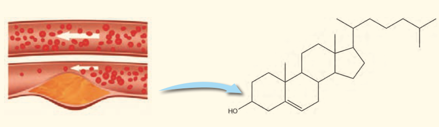

## تمرین‌های دوره‌ای

۱- اغلب ورزشکاران برای درمان آسیب‌دیدگی‌های خود از بسته‌هایی استفاده می‌کنند که به سرعت گرما را انتقال می‌دهند. اساس کار این بسته‌ها، انحلال برخی ترکیب‌های یونی در آب است. با توجه به معادله‌های ترموشیمیایی زیر به پرسش‌های مطرح شده پاسخ دهید:

$\mathrm{NH_4NO_3(s)+26\,kJ\xrightarrow{در\ آب}NH_4^+(aq)+NO_3^-(aq)}$

$\mathrm{CaCl_2(s)\xrightarrow{در\ آب}Ca^{2+}(aq)+2Cl^-(aq)+83\,kJ}$

الف) کدام فرایند انحلال برای سرد کردن محل آسیب‌دیدگی مناسب است؟ چرا؟

ب) از انحلال کامل ۲/۲۲ g کلسیم کلرید خشک در آب چند کیلوژول گرما آزاد می‌شود؟

۲- چربی ذخیره شده در کوهان شتر هنگام اکسایش افزون بر آب مورد نیاز، انرژی لازم برای فعالیت‌های جانور را نیز تأمین می‌کند. واکنش ترموشیمیایی آن به صورت زیر است:

$\mathrm{2C_{57}H_{110}O_6(s)+163O_2(g)\rightarrow 114CO_2(g)+110H_2O(l)}$، $\Delta H=-75520\,kJ$

حساب کنید از اکسایش هر کیلوگرم چربی، چند کیلوژول انرژی آزاد می‌شود؟

۳- کلسترول، یکی از مواد آلی موجود در غذاهای جانوری است که مقدار اضافی آن در دیواره رگ‌ها رسوب می‌کند، فرایندی که منجر به گرفتگی رگ‌ها و سکته می‌شود. با توجه به ساختار آن به پرسش‌های مطرح شده پاسخ دهید.

الف) توضیح دهید چرا شیمی‌دان‌ها آن را یک الکل سیرنشده می‌دانند؟

ب) با توجه به جدول شماره ۳، در شرایط یکسان کدام پیوندهای اشتراکی یگانه در ساختار کلسترول آسان‌تر شکسته می‌شود؟ چرا؟
