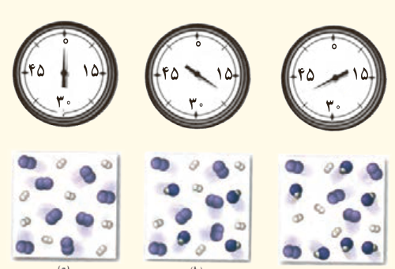

۴- از مصرف هر گرم آلومینیم در واکنش ترمیت، ۱۵/۲۴ kJ گرما آزاد می‌شود.

$\mathrm{2Al(s)+Fe_2O_3(s)\rightarrow Al_2O_3(s)+2Fe(l)}$

الف) این مقدار گرما، دمای صدگرم آب خالص را چند درجه سلسیوس افزایش می‌دهد؟

ب) ΔH واکنش ترمیت را حساب کنید.

۵- با توجه به واکنش ترموشیمیایی $\mathrm{H_2(g)+I_2(s)+53\,kJ\rightarrow 2HI(g)}$، آنتالپی واکنش $\mathrm{H_2(g)+I_2(g)\rightarrow 2HI(g)}$ را حساب کنید (راهنمایی: آنتالپی فرازش (تصعید) ید را $62/5\,kJ\,mol^{-1}$ در نظر بگیرید).

۶- شکل روبه‌رو واکنش میان گاز هیدروژن و بخار بنفش‌رنگ ید را در دمای معینی نشان می‌دهد.

اگر هر ذره هم‌ارز با ۰/۱ مول از ماده و سامانه دو لیتری باشد، سرعت واکنش را پس از ۲۰ دقیقه (b) و پس از ۴۰ دقیقه (c) برحسب $mol\,L^{-1}h^{-1}$ حساب و با یکدیگر مقایسه کنید.

۷- با توجه به معادله واکنش زیر به پرسش‌ها پاسخ دهید.

$\mathrm{CH_2=CH_2(g)+Cl_2(g)\xrightarrow{FeCl_3(s)}CH_2ClCH_2Cl(g)}$، $\Delta H=-178\,kJ\,mol^{-1}$

۱،۲- دی کلرواتان

الف) ساختار لوییس فرآورده را رسم کنید.

ب) نمودار آنتالپی واکنش را رسم کنید.

پ) حساب کنید از واکنش ۴۲ گرم گاز اتن با مقدار کافی از گاز کلر، چند کیلوژول گرما مبادله می‌شود؟

۸- ΔH واکنش $\mathrm{C_2H_4(g)+H_2(g)\xrightarrow{25^\circ C}C_2H_6(g)}$ را با استفاده از:

الف) جدول ۲ و ۳ حساب کنید.

ب) آنتالپی سوختن اتن، اتان و هیدروژن که به ترتیب برابر با −۱۴۱۰، −۱۵۶۰ و −۲۸۶ کیلوژول بر مول است، حساب کنید.

پ) ΔH محاسبه شده از کدام قسمت را برای یک گزارش علمی انتخاب می‌کنید؟ توضیح دهید.
