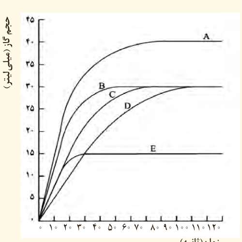

۹- با توجه به جدول روبه‌رو به پرسش‌های مطرح شده پاسخ دهید.

| ماده غذایی در ۱۰۰ g خوراکی | برگه زردآلو | سیب | بادام |
|---|---|---|---|
| ارزش غذایی (kcal) | ۲۴۱ | ۵۲ | ۵۷۹ |
| چربی (گرم) | ۰/۵۱ | ۰/۱۷ | ۴۹/۹۰ |
| کلسترول (میلی‌گرم) | − | − | − |
| کربوهیدرات (گرم) | ۷۸/۷۰ | ۲۴/۲۰ | ۲۵/۹۰ |
| پروتئین (گرم) | ۳/۳۹ | ۰/۲۶ | ۲۱/۲۰ |

الف) اگر بدن فردی نیاز فوری و ضروری به تأمین انرژی داشته باشد، کدام خوراکی را پیشنهاد می‌کنید؟ چرا؟

ب) مصرف کدام خوراکی را برای فعالیت‌های فیزیکی که در مدت طولانی‌تری انجام می‌شوند، مناسب می‌دانید؟ توضیح دهید.

پ) اگر یک فرد ۷۰ کیلوگرمی، ۲۵ گرم بادام خورده باشد، برای مصرف انرژی حاصل از آن چه مدت باید پیاده‌روی کند؟ آهنگ مصرف انرژی در پیاده‌روی را $190\,kcal\,h^{-1}$ در نظر بگیرید.

۱۰- با توجه به واکنش‌های ترموشیمیایی داده شده، آنتالپی واکنش زیر را حساب کنید.

$\mathrm{FeO(s)+CO(g)\rightarrow Fe(s)+CO_2(g)}$، $\Delta H=?$

$\mathrm{Fe_2O_3(s)+3CO(g)\rightarrow 2Fe(s)+3CO_2(g)}$، $\Delta H=-23\,kJ$

$\mathrm{3Fe_2O_3(s)+CO(g)\rightarrow 2Fe_3O_4(s)+CO_2(g)}$، $\Delta H=-39\,kJ$

$\mathrm{Fe_3O_4(s)+CO(g)\rightarrow 3FeO(s)+CO_2(g)}$، $\Delta H=18\,kJ$

۱۱- در نمودار زیر، منحنی C مربوط به واکنش ۰/۵ گرم نوار منیزیم با مقدار کافی از هیدروکلریک اسید در دمای اتاق بوده و منحنی‌های دیگر مربوط به همین واکنش اما در شرایط متفاوتی است؛ با توجه به آنها به پرسش‌ها پاسخ دهید.

الف) سرعت متوسط تولید گاز را برای آزمایش‌های C و D برحسب لیتر بر ساعت حساب کنید.

ب) کدام منحنی مربوط به واکنشی است که در آن ۰/۵ گرم پودر منیزیم به جای نوار منیزیم استفاده شده است؟ (بقیه شرایط واکنش تغییر نکرده است.) دلیل خود را توضیح دهید.

پ) کدام منحنی مربوط به واکنش ۰/۵ گرم نوار منیزیم با مقدار کافی از هیدروکلریک اسید در دمای ۵ درجه سلسیوس است؟ چرا؟
