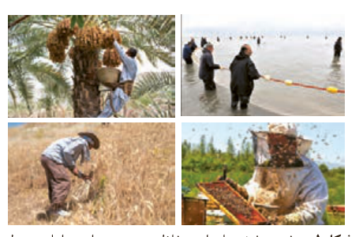
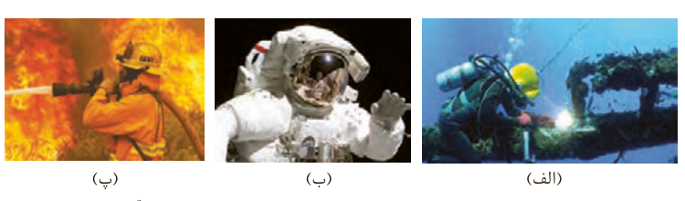

انسان در طول تاریخ، همواره به دنبال تهیه پوشاک مناسب بوده است. پوشاک افزون بر پوشش بدن، در تمدن بشری نقش بزرگی داشته است آن‌چنان که نوع پوشاک در هر قوم، نشان‌دهنده توانایی و مهارت دستی، هنر، تصویرگری، دانش، فناوری و نیز آداب و رسوم آن قوم است. پوشاک، بدن را در برابر عوامل محیطی گوناگون مانند سرما و گرما، نور خورشید، باران، تگرگ، گزند حشرات و... نیز محافظت می‌کند. برای مثال کلاه لبه‌دار، سر و صورت را در برابر تابش نور خورشید و آفتاب‌سوختگی و نیز پوشیدن کفش، پاها را در برابر خاک، سنگ، اشیای سخت، سردی و داغی زمین محافظت می‌کند (شکل ۱).

شکل ۱- برخی پوشش‌ها برای حفاظت بدن در برابر عوامل محیطی

با رشد و گسترش دانش و فناوری در صنایع و ایجاد نیازهای جدید و خاص، پوشاک گوناگونی مانند انواع کلاه ایمنی، کفش پنجه فولادی، عینک ایمنی و... تولید شد. پوشش‌هایی که هر کدام ایمنی فیزیکی بدن را در شرایط دشوار و خطرناک به‌ویژه هنگام انجام فعالیت‌ها افزایش می‌دهد. به تازگی بشر با تکیه بر دانش و فناوری‌های نو توانسته است انواع تازه‌ای از پوشاک تولید کند که از بدن در برابر مواد شیمیایی مانند اسیدها، سموم، بخارهای سمی و غلیظ، پرتوها، آلودگی‌های عفونی، آتش، گلوله و... محافظت می‌کند (شکل ۲).

شکل ۲- چند نمونه پوشاک، (الف) لباس غواصی، ب) لباس فضانورد، پ) لباس آتش‌نشان

انسان در گذشته پوشاک خود را از مواد طبیعی مانند پشم گوسفند و شتر، پوست و چرم، پنبه و... تهیه می‌کرد. با رشد جمعیت جهان، مصرف پوشاک به میزان چشمگیری افزایش یافت، به طوری که روش‌های سنتی تولید پوشاک دیگر پاسخگوی نیازهای جامعه نبود.

## آیا می‌دانید

یافته‌های باستان‌شناسی نشان می‌دهد که پیشینه ریسندگی و بافندگی از الیافی مانند پشم، ابریشم، پنبه و کتان به هزاران سال پیش برمی‌گردد. به دیگر سخن، نساجی از کهن‌ترین صنایع در تمدن بشری است که با دوک نخ‌ریسی پا به عرصه ظهور گذاشت.

سنگ‌نگاره‌ای با قدمتی حدود ۳۰۰۰ سال، تصویر یک زن عیلامی را در حال نخ‌ریسی نشان می‌دهد که خدمتگزاری در حال باد زدن اوست.
