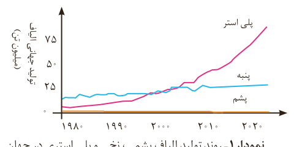
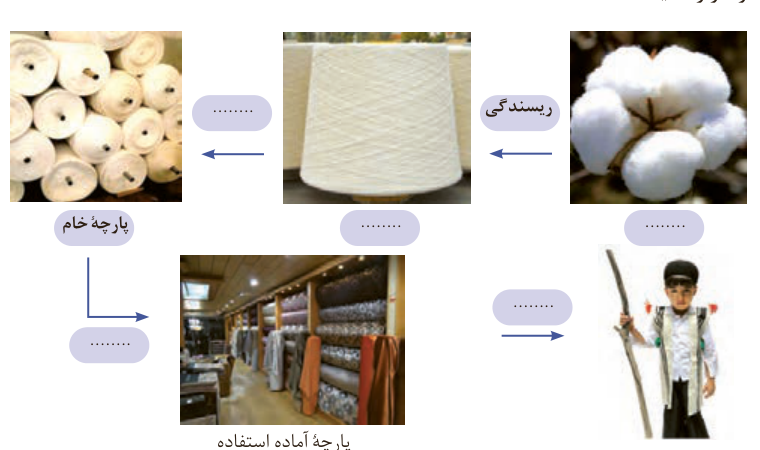

به همین دلیل صنعت نساجی به شکل صنعتی و امروزی پدیدار شد، صنعتی که با بهره‌گیری از فناوری‌های نو به تولید پوشاک پرداخت. اما موفقیت این صنعت در گرو تأمین **الیاف**¹ مورد نیاز بود. از آنجا که منابع طبیعی محدود بود، الیاف تولید شده پاسخگوی نیاز صنایع نساجی و جامعه نبود. گویی زمان آن رسیده بود که شیمی‌دان‌ها طلای سیاه را به کار بگیرند و الیافی جدید تولید کرده و راهی شرکت‌های نساجی کنند. با گذشت زمان تلاش شیمی‌دان‌ها نتیجه داد و در طول چند دهه، انواع گوناگونی از الیاف ساختگی بر پایه نفت، شناسایی و تولید شد؛ الیافی که جایگزین الیاف طبیعی شد و امروزه بخش عمده پوشاک را تشکیل می‌دهد. آمارها نشان می‌دهند که در سال ۲۰۱۴ میلادی نزدیک به صد میلیون تن انواع الیاف در جهان تولید و مصرف شده است (نمودار ۱).

نمودار ۱- روند تولید الیاف پشمی، نخی و پلی‌استری در جهان.

الیاف جمع لیف است. لیف رشته‌های نازک، بلند و مومانندی با استحکام و انعطاف‌پذیری مناسب است. از کنار هم قرار گرفتن این رشته‌ها، الیاف به دست می‌آید. در واقع با تنیدن لیف‌ها، الیاف را تولید می‌کنند.

میزان نسبی الیاف تولید شده در جهان: الیاف طبیعی و الیاف ساختگی.

## خود را بیازمایید

در هریک از جاهای خالی یکی از واژه‌های «نخ²، الیاف، دوزندگی، فراوری و بافندگی» را قرار دهید.

پنبه: ........؛ ریسندگی ← ........؛ ........ ← پارچه خام؛ ........ ← پارچه آماده استفاده؛ ........ ← پوشاک.

## آیا می‌دانید

با وجود گسترش صنعت نساجی و پوشاک، تولید فرآورده‌های دستی به دلیل بی‌نظیر، محدود و خاص بودن اهمیت و جایگاه ویژه‌ای در زندگی انسان‌ها دارند. کفش گیوه اورامانات یکی از این موارد است. کفشی که دست‌دوز بوده و همتایی ندارد. این پوشش بسیار انعطاف‌پذیر، سبک و محکم است و امکان جابه‌جایی هوا دارد. این کفش در زبان محلی به کلاش معروف است.

۱- Fibers
۲- Thread
