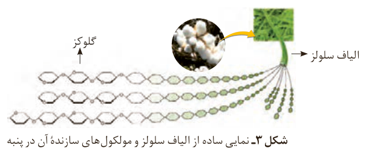

## در میان تارنماها

با مراجعه به منابع اینترنتی معتبر درباره نام و ویژگی‌های برخی پوشاک اقوام ایرانی اطلاعاتی جمع‌آوری و به کلاس گزارش کنید.

الیاف ساختگی، الیافی هستند که در طبیعت یافت نمی‌شود بلکه از واکنش بین مواد شیمیایی در شرکت‌های پتروشیمی تولید می‌شوند. در واقع اغلب فرآورده‌های پتروشیمیایی برای تولید انواع گوناگون الیاف مانند پلی‌استر، نایلون و... به کار می‌روند. از این الیاف افزون بر تهیه پارچه و پوشاک، به طور گسترده‌ای در تهیه انواع پوشش‌ها، ظروف نچسب، یکبار مصرف و پلاستیکی، فرش، پرده و... استفاده می‌شود.

اکنون این پرسش‌ها مطرح می‌شوند که الیاف ساختگی چه موادی هستند؟ چه ساختاری دارند؟ چه رابطه‌ای بین ساختار و رفتار آنها وجود دارد؟ آیا شناخت ویژگی‌های ماده و به‌ویژه ترکیب‌های آلی می‌تواند به تولید الیاف جدید منجر شود؟ آیا می‌توان الیافی تهیه کرد که در پزشکی به‌کار آید؟ واکنش‌های شیمیایی تولید الیاف در چه شرایطی انجام می‌شوند؟ مولکول‌های سازنده الیاف چه ویژگی‌هایی دارند؟ برای یافتن پاسخ این پرسش‌ها و پرسش‌هایی از این دست با ما همراه شوید.

## الیاف و درشت مولکول‌ها¹

پنبه یکی از الیاف طبیعی است که در تولید پوشاک سهم قابل توجهی دارد. آمارها نشان می‌دهد که حدود نیمی از لباس‌های تولیدی در جهان از پنبه تهیه می‌شود. از پنبه افزون بر تولید پوشاک در تولید رویه مبل، پرده، تور ماهیگیری، گاز استریل و... استفاده می‌شود. می‌دانید که الیاف پنبه از سلولز تشکیل شده، زنجیری بسیار بلند که از اتصال شمار بسیار زیادی مولکول گلوکز به یکدیگر ساخته می‌شود (شکل ۳). با این توصیف شمار اتم‌های سازنده هر مولکول سلولز، بسیار زیاد بوده و اندازه مولکول آن بزرگ است.

شکل ۳- نمایی ساده از الیاف سلولز و مولکول‌های سازنده آن در پنبه

## آیا می‌دانید

سلولز از اتصال حدود ۳۰۰۰ مولکول گلوکز به یکدیگر تشکیل می‌شود، از این‌رو فرمول مولکولی آن به تقریب $\mathrm{C_{18000}H_{30002}O_{15001}}$ است. با این توصیف جرم مولی سلولز در حدود ۴۸۷۰۰۰ گرم است. توجه کنید هر مولکول سلولز هنوز آن‌قدر کوچک است که قابل دیدن نیست.

۱- Macromolecules
