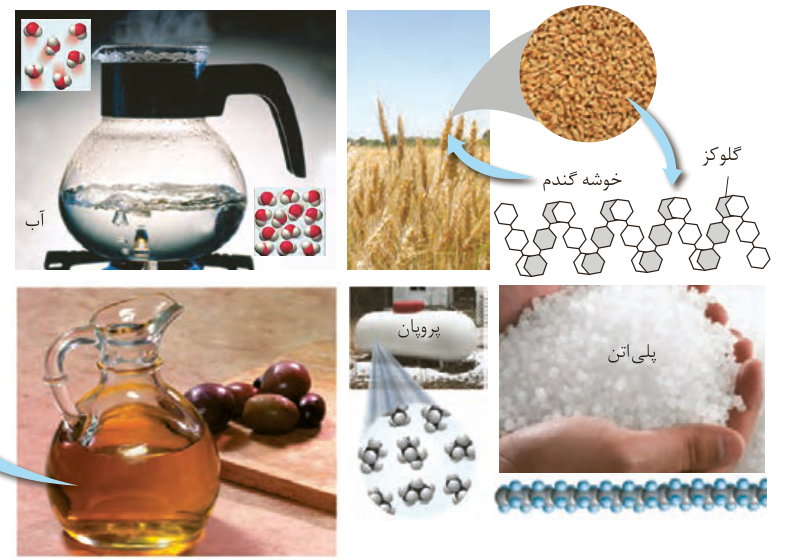

## با هم بیندیشیم

با توجه به شکل‌های زیر به پرسش‌ها پاسخ دهید.

الف) جدول را کامل کنید.

| نام ماده | اندازه مولکول: کوچک یا متوسط | اندازه مولکول: بسیار بزرگ | جرم مولی: کم یا متوسط | جرم مولی: بسیار زیاد | شمار اتم‌ها: کم یا متوسط | شمار اتم‌ها: بسیار زیاد |
|---|---|---|---|---|---|---|
| آب |  |  |  |  |  |  |
| پلی‌اتن |  |  |  |  |  |  |
| پروپان |  |  |  |  |  |  |
| نشاسته گندم |  |  |  |  |  |  |
| انسولین |  | * |  | * |  | * |
| سلولز |  |  |  |  |  |  |
| روغن زیتون |  |  |  |  |  |  |

ب) به دسته‌ای از ترکیب‌های جدول، درشت مولکول می‌گویند. این مفهوم را در یک سطر تعریف کنید.

## آیا می‌دانید

انسولین، هورمون تنظیم‌کننده قند خون بوده و شکل زیر نمایی از ساختار این هورمون است.

گلوکز، سازنده مولکول‌های نشاسته و سلولز است؛ اما به دلیل تفاوت ساختار مولکول‌های نشاسته و سلولز، خواص آنها متفاوت است.

| نام ماده | جرم مولی ($g\,mol^{-1}$) |
|---|---|
| اتن | ۲۸/۰۵ |
| اتانول | ۴۶/۰۷ |
| انسولین | ۵۸۳۱/۶۵ |
| نایلون | $10^4-10^6$ |
| پلی‌اتن | $10^4-10^5$ |
