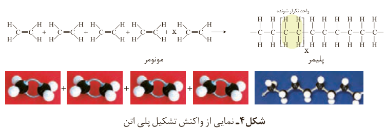
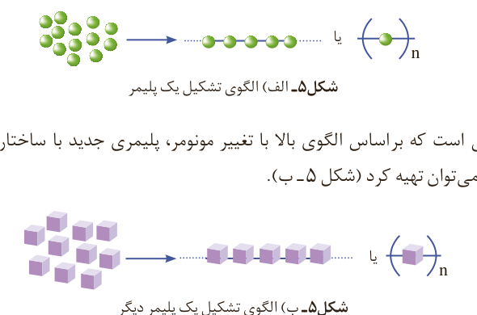

از پیوندهای دوگانه در اتن شکسته شده و مولکول‌های اتن از سوی اتم‌های کربن به یکدیگر متصل می‌شوند. با ادامه این روند، شمار زیادی از مولکول‌های اتن به یکدیگر افزوده شده و مولکول‌هایی با زنجیر کربنی بلند ایجاد می‌شوند (شکل ۴).

شکل ۴- نمایی از واکنش تشکیل پلی‌اتن: مونومر، پلیمر، واحد تکرارشونده.

به واکنش‌دهنده‌ها در واکنش پلیمری شدن، **مونومر**¹ (تک‌پار) می‌گویند. در این واکنش‌ها شمار زیادی از مونومرها با یکدیگر واکنش می‌دهند و پلیمر را می‌سازند. مطابق شکل ۴ مونومرهای اتن به یکدیگر افزوده می‌شوند و پلی‌اتن را پدید می‌آورند. با دقت در ساختار پلی‌اتن درمی‌یابید که این ترکیب از تکرار مجموعه‌ای از اتم‌های کربن و هیدروژن به نام واحد تکرارشونده پدید آمده است. توجه کنید که تعیین تعداد دقیق مونومرهای شرکت‌کننده در یک واکنش پلیمری شدن ممکن نیست و تاکنون هیچ قاعده‌ای برای اتصال شمار مونومرها به یکدیگر ارائه نشده است. به همین دلیل برای پلیمرها نمی‌توان فرمول مولکولی دقیقی نوشت. شیمی‌دان‌ها برای نمایش آنها، واحد تکرارشونده را درون کمانک نوشته و زیروند n را جلوی آن می‌نویسند (شکل ۵- الف و ب).

شکل ۵- الف) الگوی تشکیل یک پلیمر

بدیهی است که براساس الگوی بالا با تغییر مونومر، پلیمری جدید با ساختار و خواص متفاوت می‌توان تهیه کرد (شکل ۵- ب).

شکل ۵- ب) الگوی تشکیل یک پلیمر دیگر

## آیا می‌دانید

سالانه در حدود ۱۰۰٬۰۰۰٬۰۰۰٬۰۰۰ کیلوگرم بسپار در شرکت‌های پتروشیمی در سراسر دنیا تولید می‌شود، به طوری که سرانه آن به ازای هر نفر حدود ۱۵ کیلوگرم برآورد می‌شود. تاکنون حدود ۶۰۰۰۰ نوع پلیمر ساختگی تولید شده است.

۱- Monomer
