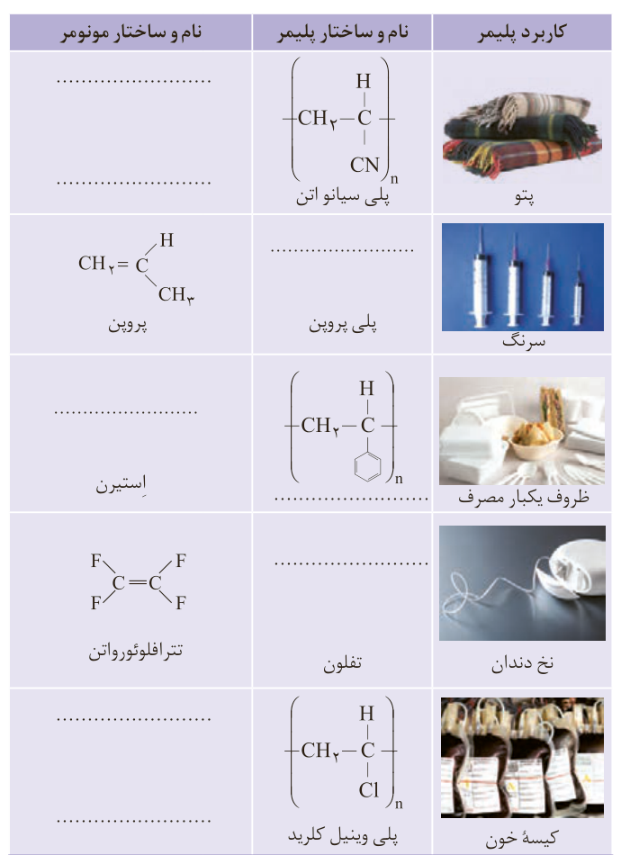

به یاد داشته باشید هر ترکیب آلی که در ساختار خود پیوند دوگانه کربن-کربن ($\mathrm{C=C}$) در زنجیر کربنی داشته باشد، می‌تواند در این نوع واکنش پلیمری شدن شرکت کند. بر همین اساس، ترکیب‌های سیرنشده و حاوی چنین پیوندی در زنجیر کربنی می‌توانند در صنایع پتروشیمی با تأمین شرایط مناسب واکنش داده و پلیمرهای گوناگونی تولید کنند.

## خود را بیازمایید

در جدول زیر هر یک از جاهای خالی را پر کنید.

| کاربرد پلیمر | نام و ساختار پلیمر | نام و ساختار مونومر |
|---|---|---|
| پتو | پلی سیانواتن، $\mathrm{(-CH_2-CH(CN)-)_n}$ | ................. |
| سرنگ | پلی پروپن، ................. | پروپن، $\mathrm{CH_2=CH-CH_3}$ |
| ظروف یکبار مصرف | .................، $\mathrm{(-CH_2-CH(C_6H_5)-)_n}$ | استیرن، ................. |
| نخ دندان | تفلون، ................. | تترافلوئورواتن، $\mathrm{CF_2=CF_2}$ |
| کیسه خون | پلی وینیل کلرید، $\mathrm{(-CH_2-CHCl-)_n}$ | ................. |

## آیا می‌دانید

پلی وینیل استات پلیمری است که در تهیه انواع پاستیل به کار می‌رود.

قرار دادن لایه‌ای از پلی وینیل کلرید بین دو صفحه شیشه‌ای مانع از فرو ریختن خرده‌های آن در اثر ضربه می‌شود.
