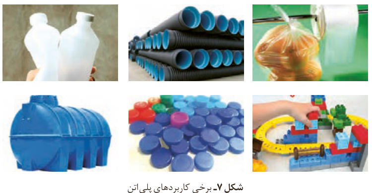

## پیوند با صنعت

پلی‌اتن یکی از مهم‌ترین پلیمرهای ساختگی است که سالانه میلیون‌ها تن از آن در شرکت‌های پتروشیمی تولید شده و برای ساخت وسایل گوناگون استفاده می‌شود (شکل ۷).

شکل ۷- برخی کاربردهای پلی‌اتن

همان‌طور که مشاهده می‌کنید کالاهای ساخته شده از پلی‌اتن ویژگی‌های گوناگونی دارند. برخی مانند کیسه پلاستیک موجود در مغازه‌ها و فروشگاه‌ها شفاف بوده و کمی انعطاف‌پذیرند درحالی که برخی دیگر مانند لوله‌های پلاستیکی، دبه‌های آب یا بطری کدر شیر، سخت‌تر و محکم‌تر هستند. یک تفاوت آشکار دیگر بین آنها تفاوت در چگالی است. آیا می‌دانید چگونه ممکن است این مواد از یک نوع پلیمر با مونومرهای یکسان تولید شوند، اما ویژگی‌های متفاوت و گاهی متضاد داشته باشند؟ آیا ساختار مولکول‌های سازنده این کالاها یکسان است؟

یافته‌های تجربی نشان داد که اتن در شرایط گوناگون، با انجام واکنش پلیمری شدن فرآورده‌هایی با ساختار متفاوت پدید می‌آورد. نوعی پلی‌اتن، چگالی کمتری داشته و شفاف است، از این‌رو به **پلی‌اتن سبک**¹ معروف است درحالی که **پلی‌اتن سنگین**²، چگالی بیشتری داشته و کدر است. شکل ۸ ساختار کلی این پلی‌اتن‌ها را نشان می‌دهد.

همان‌طور که در شکل ۸ می‌بینید، مولکول‌های اتن می‌توانند به دو صورت به یکدیگر افزوده شوند و دو فرآورده متفاوت ایجاد کنند. مولکول‌های اتن در شرایط معین پشت سرهم به یکدیگر متصل شده و زنجیرهای بلند و بدون شاخه ایجاد می‌شود. اما در شرایطی دیگر برخی مولکول‌های اتن از کناره‌ها به یکدیگر افزوده شده و زنجیرهای شاخه‌دار تولید می‌شود.

## آیا می‌دانید

یافتن روش مناسب و شرایط بهینه برای انجام واکنش‌های شیمیایی آن‌قدر مهم است که به مناسب‌ترین روش‌ها جایزه نوبل اختصاص می‌دهند. یافتن روش مناسب برای تولید پلی‌اتن سنگین (بدون شاخه) سال‌ها طول کشید و در نهایت دو شیمی‌دان آلمانی و ایتالیایی به نام‌های کارل زیگلر (Karl Ziegler، ۱۸۹۸–۱۹۷۳) و جولیانو ناتا (Giulio Natta، ۱۹۰۳–۱۹۷۹) برنده جایزه نوبل شیمی شدند. آنها موفق شدند کاتالیزگری بیابند که واکنش پلیمری شدن اتن را بدون ایجاد شاخه فرعی پیش می‌برد.

پلی‌اتن مذاب را در دستگاهی با عمل دمیدن هوا به ورقه نازک پلاستیکی تبدیل می‌کنند.

۱- Low Density Poly Ethene (LDPE)
۲- High Density Poly Ethene (HDPE)
