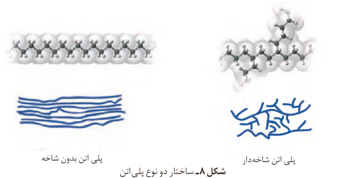

شکل ۸- ساختار دو نوع پلی‌اتن: پلی‌اتن بدون شاخه، پلی‌اتن شاخه‌دار.

## خود را بیازمایید

داده‌های تجربی نشان می‌دهد که چگالی پلی‌اتن‌های نشان داده شده در شکل ۸ برابر با ۰/۹۷ و ۰/۹۲ گرم بر سانتی‌متر مکعب است.

الف) کدام چگالی به کدام پلی‌اتن تعلق دارد؟ چرا؟

ب) کدام پلی‌اتن سبک و کدام سنگین است؟

پ) نیروی بین مولکولی در پلی‌اتن چیست؟

ت) چرا استحکام پلی‌اتن سنگین از سبک بیشتر است؟

تاکنون با پلیمرهایی آشنا شدید که از واکنش مونومرهای دارای پیوند دوگانه کربن-کربن در زنجیر کربنی به دست می‌آیند. افزون بر آنها در صنعت، پلیمرهای دیگری نیز ساخته شده است، پلیمرهایی که در ساختار آنها افزون بر اتم‌های کربن و هیدروژن، اتم‌های دیگری مانند اکسیژن، نیتروژن و... وجود دارند. در ادامه با تهیه، ساختار و کاربرد این پلیمرها آشنا می‌شوید.

## پلی‌استرها

نیاز به تولید پوشاک بیشتر و با کاربردهای گسترده‌تر، شیمی‌دان‌ها را برای یافتن پلیمرهای جدید تشویق می‌کرد. آنها با بررسی رفتار انواع مواد آلی، موفق به تهیه و ساخت پلیمرهایی شدند که در ساختار آنها اتم‌های اکسیژن و نیتروژن نیز وجود داشت. پلی‌استرها دسته‌ای از آنها هستند که از اتم‌های C، H و O تشکیل شده‌اند. از این پلیمرها می‌توان الیاف، نخ و

## آیا می‌دانید

پلی‌اتن سبک از پلیمری شدن گاز اتن در دمای ۲۰۰ °C و در فشار ۲۰۰۰ atm و در حضور مقدار ناچیزی از گاز اکسیژن به‌دست می‌آید. در حالی که پلی‌اتن سنگین از پلیمری شدن گاز اتن در دمای ۶۰ °C و فشار ۲۰ atm و در حضور مقدار کمی از کاتالیزگر زیگلر-ناتا تولید می‌شود.

مقدار n در ساختار یک پلیمر نشان می‌دهد که چه تعداد از مولکول‌های مونومر با هم واکنش داده و مولکول آن پلیمر را ساخته‌اند. مقدار n برای تعدادی از پلیمرها در جدول زیر نشان داده شده است.

| نام پلیمر | n |
|---|---|
| پلی‌اتن سبک | $1\times10^4$ |
| پلی‌اتن سنگین | $2\times10^5$ |
| پلی‌استیرن | $3\times10^3$ |
| پلی وینیل کلرید | $1/5\times10^3$ |
