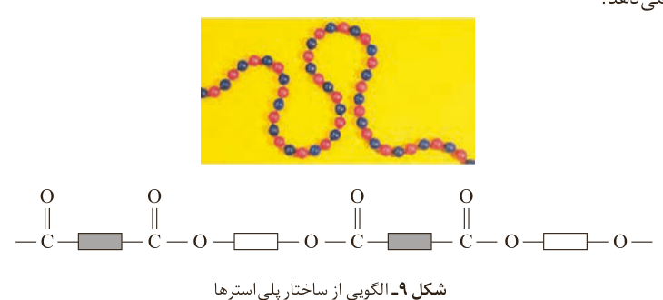
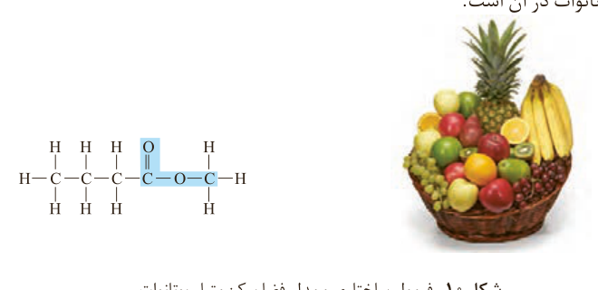
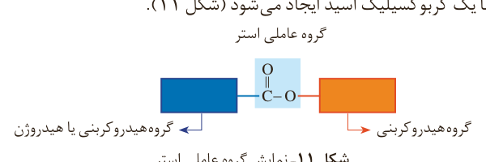

در نهایت پارچه‌های پلی‌استری تولید کرد. شکل ۹ نمایی از ساختار کلی پلی‌استرها را نشان می‌دهد.

شکل ۹- الگویی از ساختار پلی‌استرها

برای اینکه بدانید چنین پلیمرهایی از چه موادی تهیه می‌شوند، افزون بر گروه عاملی هیدروکسیل باید با گروه عاملی کربوکسیل و به‌ویژه گروه عاملی استر و برخی رفتار آنها بیشتر آشنا شوید.

استرها دسته‌ای از مواد آلی هستند که منشأ بوی خوش شکوفه‌ها، گل‌ها، عطرها و نیز بو و طعم میوه‌ها هستند (شکل ۱۰). برای نمونه، بو و طعم خوش آناناس به دلیل وجود متیل بوتانوات در آن است.

شکل ۱۰- فرمول ساختاری و مدل فضا پرکن متیل بوتانوات

با دقت در ساختار مولکول استر درمی‌یابید که به گروه عاملی آن دو بخش یا دو زنجیر هیدروکربنی متصل است. در یک سوی آن گروه هیدروکربنی به اتم اکسیژن و در سوی دیگر آن به اتم کربن این گروه متصل است. در ادامه خواهید دید که گروه عاملی استری از واکنش یک الکل با یک کربوکسیلیک اسید ایجاد می‌شود (شکل ۱۱).

شکل ۱۱- نمایش گروه عاملی استر: گروه هیدروکربنی یا هیدروژن، گروه عاملی استر، گروه هیدروکربنی.

## آیا می‌دانید

بوی خوش گل یاسمن به دلیل وجود نوعی استر است.
