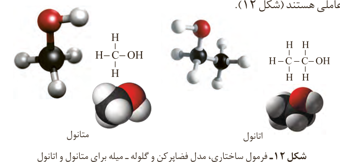
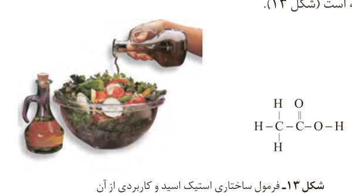

## الکل‌ها و اسیدها

آموختید الکل‌ها، ترکیب‌هایی هستند که در ساختار آنها یک یا چند گروه هیدروکسیل ($\mathrm{-OH}$) با یک پیوند اشتراکی به اتم کربن متصل است. متانول و اتانول دو عضو خانواده الکل‌های یک عاملی هستند (شکل ۱۲).

شکل ۱۲- فرمول ساختاری، مدل فضاپرکن و گلوله-میله برای متانول و اتانول

الکل‌های یک عاملی را می‌توان با فرمول ROH نشان داد که در آن، R یک زنجیر هیدروکربنی است.

کربوکسیلیک اسیدها نیز دسته‌ای دیگر از ترکیب‌های آلی هستند که گروه عاملی کربوکسیل ($\mathrm{-COOH}$) دارند. این ترکیب‌ها مزه ترش دارند به طوری که مزه ترش میوه‌هایی مانند انگور، لیمو ترش، کیوی، گوجه سبز و... ناشی از وجود چنین مولکول‌هایی در آنهاست. متانوئیک (فورمیک) اسید، HCOOH، اولین عضو خانواده کربوکسیلیک اسیدهاست که بر اثر گزش مورچه سرخ وارد بدن شده و باعث سوزش و خارش در محل گزیدگی می‌شود.

اتانوئیک اسید (استیک اسید) یک اسید دو کربنی است که یکی از پرکاربردترین اسیدها در زندگی روزانه است (شکل ۱۳).

شکل ۱۳- فرمول ساختاری استیک اسید و کاربردی از آن

کربوکسیلیک اسیدهای یک عاملی را می‌توان با فرمول RCOOH یا $\mathrm{R-C(=O)-OH}$ نشان داد که در آن R، یک زنجیر هیدروکربنی یا هیدروژن است.

## آیا می‌دانید

متانوئیک اسید ساده‌ترین اسید آلی است که در سال ۱۶۷۰ کشف شد و چون از تقطیر مورچه سرخ به‌دست می‌آمد، نام فورمیک اسید یا جوهر مورچه بر آن نهادند. در زبان لاتین به مورچه فورمیکا می‌گویند.
