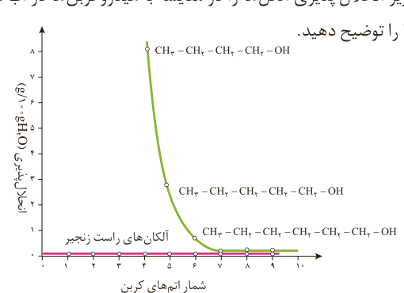

## با هم بیندیشیم

با توجه به دو ساختار داده شده به پرسش‌ها پاسخ دهید:

$\mathrm{CH_3-CH_2-OH}$

$\mathrm{CH_3-CH_2-CH_2-CH_2-CH_2-CH_2-CH_2-CH_2-OH}$

الف) پیش‌بینی کنید چه نوع نیروهای بین مولکولی در این دو الکل وجود دارد؟

ب) مولکول این الکل‌ها دو بخش قطبی و ناقطبی دارند. با توجه به اینکه گشتاور دوقطبی هیدروکربن‌ها حدود صفر است، این دو بخش را در هر مولکول بالا مشخص کنید.

پ) پیش‌بینی کنید در شرایط یکسان انحلال‌پذیری کدام الکل در آب بیشتر است؟

ت) درستی پیش‌بینی خود را با توجه به داده‌های جدول زیر بررسی کنید.

| فرمول الکل | انحلال‌پذیری ($g/100gH_2O$) |
|---|---|
| $\mathrm{CH_3CH_2OH}$ | به هر نسبتی حل می‌شود |
| $\mathrm{CH_3CH_2CH_2CH_2CH_2CH_2CH_2CH_2OH}$ | ۰/۰۴۶ |

ث) درباره درستی جمله زیر گفت‌وگو کنید.

«با افزایش طول زنجیر هیدروکربنی در الکل‌ها، نیروی وان‌دروالس بر هیدروژنی غلبه می‌کند و ویژگی ناقطبی الکل افزایش می‌یابد.»

ج) نمودار زیر انحلال‌پذیری الکل‌ها را در مقایسه با هیدروکربن‌ها در آب نشان می‌دهد. روند تغییر آنها را توضیح دهید.

دریافتید که مولکول الکل‌ها دو بخش قطبی و ناقطبی دارد. زنجیر هیدروکربنی، بخش ناقطبی مولکول و گروه عاملی هیدروکسیل، بخش قطبی مولکول را تشکیل می‌دهد. بنابراین
