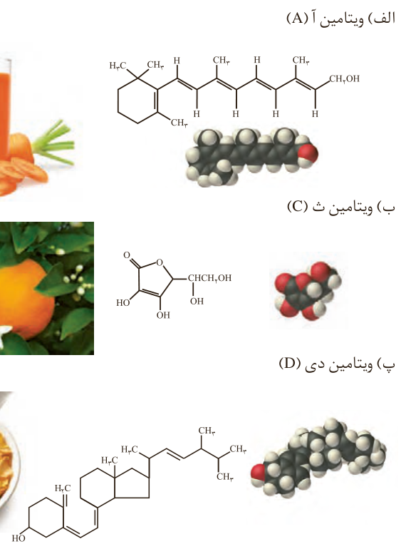
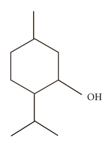

در الکل‌ها دو نوع نیروی بین مولکولی هیدروژنی و وان‌دروالسی وجود دارد. به طوری که در الکل‌های کوچک و تا پنج کربن، بخش قطبی بر ناقطبی غلبه دارد و الکل در آب محلول است. به دیگر سخن، نیروی بین مولکولی غالب در الکل‌ها تا پنج کربن از نوع هیدروژنی بوده و به همین دلیل به‌خوبی در آب حل می‌شوند. اما با افزایش شمار اتم‌های کربن، بخش ناقطبی مولکول بزرگ‌تر شده و میزان قطبیت مولکول کاهش می‌یابد. این روند سبب می‌شود که الکل‌های بزرگ‌تر در آب حل نشوند بلکه در چربی حل شوند. از این رو ویژگی چربی‌دوستی الکل‌ها با افزایش شمار اتم‌های کربن، افزایش می‌یابد. به بیان دیگر، هرچه شمار اتم‌های کربن الکل‌ها بیشتر شود، ویژگی آب‌گریزی آنها افزایش می‌یابد.

## خود را بیازمایید

۱- کدام ویتامین‌های زیر در آب و کدام‌ها در چربی حل می‌شود؟ چرا؟

الف) ویتامین آ (A)

ب) ویتامین ث (C)

پ) ویتامین دی (D)

## آیا می‌دانید

منتول الکلی با فرمول ساختاری زیر است که بوی نعناع و سوسنبر ناشی از آن است. از منتول در تهیه برخی آدامس‌ها، آب‌نبات‌ها و داروها استفاده می‌شود.

شاید تاکنون با افرادی روبه‌رو شده‌اید که از گرفتگی عضلات، کمردرد، دردهای عضلانی و درد مفاصل رنج می‌برند. این افراد برای کاهش درد خود از پمادهای موضعی گوناگونی استفاده می‌کنند که دارای چندین ماده آلی هستند. یکی از ترکیب‌های آلی موجود در برخی از آنها منتول است.
