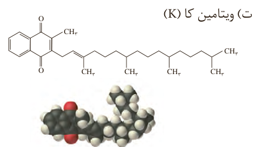

ت) ویتامین کا (K)

۲- مصرف بیش از اندازه کدام دسته از ویتامین‌ها برای بدن مشکل خاصی ایجاد نمی‌کند؟ چرا؟

۳- گروه‌های عاملی موجود در هر یک از ترکیب‌های بالا را مشخص کنید.

۴- عبارت زیر را با خط زدن واژه نادرست در هر مورد کامل کنید.

در ترکیب‌های آلی مانند الکل‌ها و کربوکسیلیک اسیدها که دو بخش قطبی و ناقطبی دارند، با افزایش طول زنجیر کربنی بخش (ناقطبی / قطبی) بزرگ‌تر می‌شود، قطبیت مولکول (کاهش / افزایش) می‌یابد و انحلال‌پذیری آن در آب (بیشتر / کمتر) می‌شود.

حفظ کردن فرمول شیمیایی مواد آلی و ارزشیابی از آنها، جزو اهداف کتاب نیست و نباید در آزمون‌های نهایی و کنکور سراسری مورد ارزیابی قرار گیرد.

## واکنش استری شدن

یکی از ویژگی‌های مهم و کاربردی کربوکسیلیک اسیدها و الکل‌ها، واکنش میان آنهاست. این مواد در شرایط مناسب واکنش می‌دهند و با از دست دادن آب، به استر تبدیل می‌شوند. معادله زیر واکنش شیمیایی انجام شده را توصیف می‌کند.

$\mathrm{R-C(=O)-OH+H-OR'\xrightarrow{H_2SO_4}R-C(=O)-OR'+H_2O}$

کربوکسیلیک اسید + الکل → استر + آب

با این توصیف از واکنش استیک اسید با اتانول، طبق معادله زیر اتیل استات به دست می‌آید.

$\mathrm{CH_3-C(=O)-OH+HOCH_2CH_3\xrightarrow{H_2SO_4}CH_3-C(=O)-OCH_2CH_3+H_2O}$

اتانوئیک اسید + اتانول → اتیل اتانوات

## آیا می‌دانید

طعم یک ماده غذایی و میوه از کنار هم قرار گرفتن شمار زیادی از ترکیب‌های شیمیایی ایجاد می‌شود. برای مثال، پرتقال دارای ۲۵۰ نوع ماده شیمیایی است که با هم طعم آن را می‌سازند. استرها از مواد اصلی سازنده طعم و بوی مواد غذایی هستند. شیمی‌دان‌ها با شناسایی اجزای سازنده طعم‌های گوناگون، آنها را در آزمایشگاه و صنعت تهیه و تولید می‌کنند.
