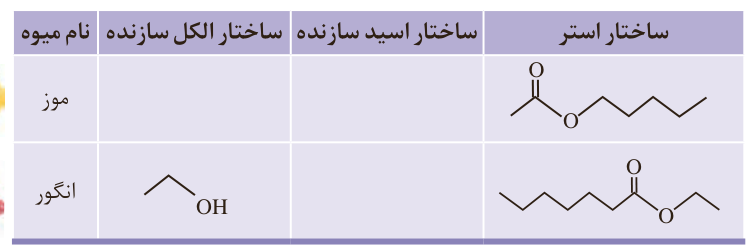
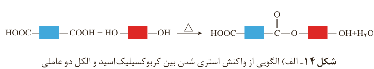

به همین ترتیب می‌توان متیل بوتانوات را در مقیاس صنعتی تولید و از آن برای تولید شوینده با بوی آناناس استفاده کرد.

$\mathrm{CH_3CH_2CH_2-C(=O)-OH+HO-CH_3\xrightarrow{H_2SO_4}CH_3CH_2CH_2-C(=O)-O-CH_3+H_2O}$

بوتانوئیک اسید + متانول → متیل بوتانوات

## خود را بیازمایید

با رسم ساختار الکل و اسید سازنده برای هر استر، جدول زیر را کامل کنید.

| ساختار استر | ساختار اسید سازنده | ساختار الکل سازنده | نام میوه |
|---|---|---|---|
| تصویر ساختار استر |  |  | موز |
| تصویر ساختار استر |  | $\mathrm{CH_3CH_2OH}$ | انگور |

اکنون با توجه به واکنش استری شدن، می‌توان نتیجه گرفت که از واکنش یک کربوکسیلیک اسید دوعاملی با یک الکل دو عاملی در شرایط مناسب، یک پلی‌استر تولید می‌شود. در مرحله نخست این واکنش، یکی از گروه‌های هیدروکسیل موجود در الکل با یکی از گروه‌های کربوکسیل موجود در اسید ترکیب شده و با از دست دادن آب، گروه عاملی استری را ایجاد می‌کند (شکل ۱۴-الف).

شکل ۱۴- الف) الگویی از واکنش استری شدن بین کربوکسیلیک اسید و الکل دو عاملی

همان‌طور که در شکل ۱۴-الف می‌بینید در ساختار فرآورده، همچنان یک گروه عاملی هیدروکسیل و یک گروه عاملی کربوکسیل وجود دارد. این ساختار نوید می‌دهد که واکنش استری شدن می‌تواند ادامه پیدا کند، آن‌چنان که از یک سو با عامل اسیدی و از سوی دیگر با عامل الکلی در واکنش شرکت می‌کند. با ادامه این روند مولکول‌های بیشتر و بیشتری با یکدیگر واکنش می‌دهند و سرانجام مولکول‌هایی با زنجیر بلند و شمار زیادی عامل استری تشکیل می‌شود. فرآورده‌ای که **پلی‌استر**¹ نامیده می‌شود (شکل ۱۴-ب).

## آیا می‌دانید

اسیدهای موجود در انگور و ریواس به ترتیب تارتاریک اسید و اگزالیک اسید نام دارند.

$\mathrm{HOOC-COOH}$

$\mathrm{HO-CH(COOH)-CH(OH)-COOH}$

۱- Polyester
