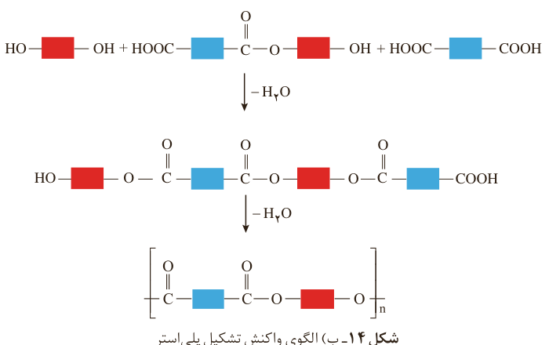

شکل ۱۴- ب) الگوی واکنش تشکیل پلی‌استر

می‌دانید که رفتار و ویژگی‌های مواد به ساختار آنها بستگی دارد. بنابراین با استفاده از کربوکسیلیک اسیدها و الکل‌های دو عاملی گوناگون، پلی‌استرهایی با ساختار متفاوت و گوناگون می‌توان تهیه کرد. پلیمرهایی که به دلیل داشتن خواص معین و منحصر به فرد، کاربردهای ویژه‌ای دارند. گوناگونی رفتار پلیمرها سبب شد تا شیمی‌دان‌های بیشتری به بررسی واکنش پلیمری شدن علاقه‌مند شوند. نتیجه این بررسی‌ها شناسایی دسته تازه‌ای از پلیمرها بود.

## پلی‌آمیدها

پلیمرهای طبیعی زیادی شناسایی شده است که در ساختار آنها اتم‌های C، H، O و N وجود دارد. مو، ناخن، پوست بدن ما همچنین شاخ حیوانات و پشم گوسفند نمونه‌ای از این پلیمرهای طبیعی هستند. در این دسته از پلیمرها گروه عاملی آمید ($\mathrm{-C(=O)-N-}$) در طول زنجیر کربنی تکرار شده است (شکل ۱۵).

شکل ۱۵- نمونه‌هایی از پلیمرهای طبیعی

عامل آمیدی از واکنش اسید آلی با آمین به دست می‌آید. آمین، ترکیبی آلی است که در ساختار آنها اتم‌های C، H و N وجود دارد. متیل آمین، ساده‌ترین آمین است. وجود اتم نیتروژن، خواص شیمیایی و فیزیکی منحصر به فردی به آمین‌ها داده است (شکل ۱۶). به طوری که بوی ماهی ناشی از آمین‌های موجود در آن است.

## آیا می‌دانید

نخ‌های خیاطی از جنس پلی‌استر هستند. هر چه مولکول سازنده پلی‌استر طولانی‌تر باشد، نیروی بین آنها قوی‌تر و استحکام نخ آن بیشتر است.

بوی ماهی به دلیل وجود متیل‌آمین و برخی آمین‌های دیگر است.
