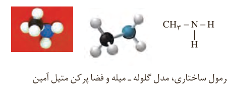
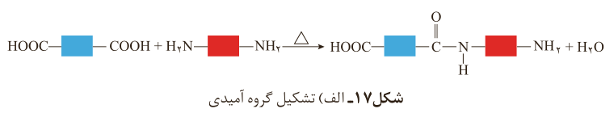
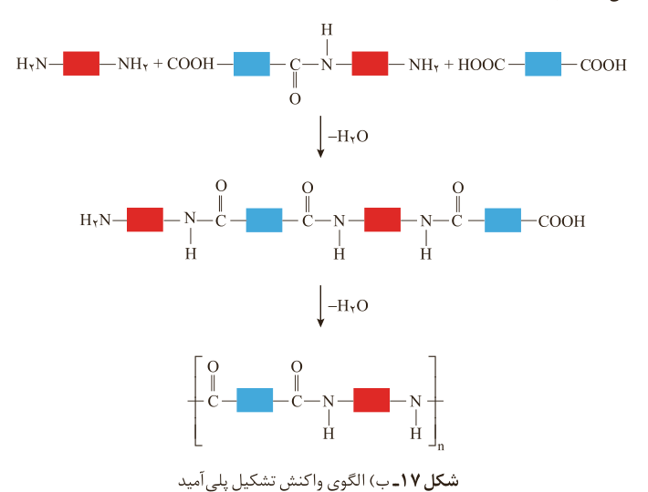

شکل ۱۶- فرمول ساختاری، مدل گلوله-میله و فضاپرکن متیل‌آمین

واکنش تولید پلی‌آمید شبیه به تولید پلی‌استر است با این تفاوت که به جای گروه عاملی الکل، گروه عاملی آمین با گروه کربوکسیل واکنش می‌دهد (شکل ۱۷- الف).

شکل ۱۷- الف) تشکیل گروه آمیدی

با ادامه واکنش، گروه‌های آمیدی بیشتری تشکیل شده و سرانجام **پلی‌آمید**¹ تولید می‌شود (شکل ۱۷- ب).

شکل ۱۷- ب) الگوی واکنش تشکیل پلی‌آمید

پلی‌آمیدهای ساختگی را در صنایع پتروشیمی از واکنش دی‌آمین‌ها با دی‌اسیدها تولید می‌کنند. **کولار**² یکی از معروف‌ترین پلی‌آمیدها است. این پلیمر از فولاد هم‌جرم خود پنج برابر مقاوم‌تر است. از کولار در تهیه تایر اتومبیل، قایق بادبانی، لباس‌های مخصوص مسابقه موتورسوارى و جلیقه‌های ضدگلوله استفاده می‌شود (شکل ۱۸).

پوشاک دوخته شده از کولار سبک و بسیار محکم بوده و در برابر ضربه، خراش و بریدگی مقاوم است. این پلیمر تاکنون جان میلیون‌ها انسان را در حوادث گوناگون نجات داده است.

۱- Polyamide
۲- Kevlar
