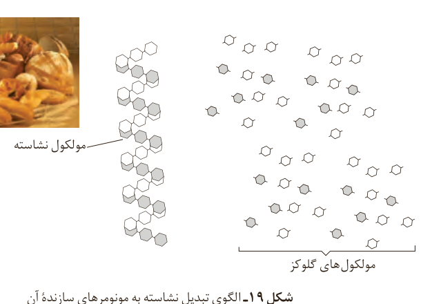

شکل ۱۸- برخی کاربردهای کولار

## پلیمرها، ماندگار یا تخریب‌پذیر

آیا نان یا سیب‌زمینی مزه‌ای شیرین دارد؟ نان و سیب‌زمینی از نشاسته غنی هستند. نشاسته، پلی‌ساکاریدی است که از اتصال مولکول‌های گلوکز به یکدیگر تشکیل شده است. اینک پاسخ شما به پرسش بالا چیست؟ واقعیت این است که اگر نان را برای مدت طولانی‌تری در دهان بجوید، مزه‌ای شیرین احساس خواهید کرد. سیب‌زمینی پخته نیز اندکی مزه شیرین دارد. این مزه شیرین ناشی از چیست؟

شیمی‌دان‌ها بر اساس یافته‌های تجربی دریافته‌اند که مولکول‌های نشاسته در شرایط مناسب مانند محیط مرطوب با کاتالیزگر یا محیط گرم و مرطوب به آرامی به مونومرهای سازنده (گلوکز) تبدیل می‌شوند و مزه شیرین ایجاد می‌کنند. نشاسته هنگام گوارش (که از دهان آغاز می‌شود) به گلوکز تبدیل می‌گردد. در واقع گوارش نشاسته شامل واکنش شیمیایی تبدیل آن است که به کمک آنزیم‌ها تسریع می‌شود (شکل ۱۹).

شکل ۱۹- الگوی تبدیل نشاسته به مونومرهای سازنده آن: مولکول نشاسته، مولکول‌های گلوکز.

استرها نیز در شرایط مناسب با آب واکنش می‌دهند و به الکل و اسید آلی سازنده تبدیل می‌شوند. این واکنش به آبکافت استرها معروف است. برای نمونه معادله صفحه بعد آبکافت

## آیا می‌دانید

برخی میوه‌های کال و نارس نشاسته دارند. این نشاسته هم‌زمان با رسیدن میوه به گلوکز تبدیل می‌شود و مزه شیرین آن را ایجاد می‌کند. البته شیرینی میوه‌ها به دلیل وجود دیگر قندهای ساده از جمله فروکتوز نیز هست.
