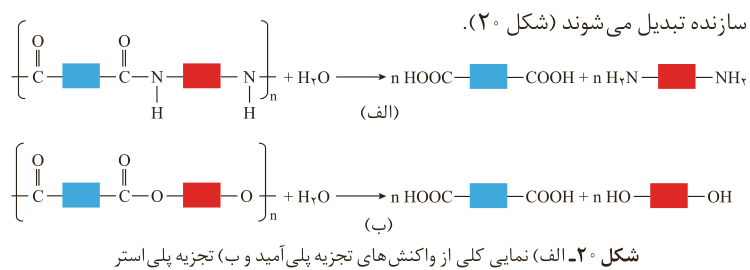

اتیل بوتانوات را نشان می‌دهد که اتانول و بوتانوئیک اسید را تولید می‌کند.

$\mathrm{CH_3CH_2CH_2-C(=O)-O-CH_2CH_3+H_2O\xrightarrow{H_2SO_4}CH_3CH_2CH_2-C(=O)-OH+HO-CH_2CH_3}$

اتیل بوتانوات → بوتانوئیک اسید + اتانول

پلی‌آمیدها و پلی‌استرها نیز در شرایط مناسب با آب واکنش می‌دهند و به مونومرهای سازنده تبدیل می‌شوند (شکل ۲۰).

شکل ۲۰- الف) نمایی کلی از واکنش‌های تجزیه پلی‌آمید و ب) تجزیه پلی‌استر

با توجه به اینکه هر نوع پوشاک تاریخ مصرفی دارد می‌توان گفت پس از مدتی تار و پود آنها سست و پوسیده می‌شوند زیرا مولکول‌های پلیمر سازنده آنها با مولکول‌های موجود در محیط پیرامون واکنش می‌دهند و برخی از پیوندهای موجود در ساختار آنها مانند پیوند استری یا آمیدی شکسته می‌شوند. با شکستن این پیوندها، استحکام الیاف پارچه کم شده و تار و پود آن به سادگی گسسته می‌شود. بدیهی است که هرچه آهنگ شکستن این پیوندها سریع‌تر باشد، فرایند پوسیده شدن پارچه سریع‌تر رخ می‌دهد.

مواد زیست تخریب‌پذیر موادی هستند که در طبیعت توسط جانداران ذره‌بینی به مولکول‌های ساده و کوچک مانند کربن دی‌اکسید، متان، آب و... تبدیل می‌شوند. پلیمرهای طبیعی زیست تخریب‌پذیرند.

## خود را بیازمایید

۱- در کدام شرایط زیر لباس‌های نخی زودتر پوسیده می‌شوند؟ چرا؟

الف) محیط سرد و خشک　　ب) محیط گرم و مرطوب

۲- چرا استفاده بی‌رویه از شوینده‌ها در شستن لباس‌ها سبب پوسیده شدن سریع‌تر آنها می‌شود؟

۳- اگر لباس‌ها را برای مدت طولانی در محلول آب و شوینده قرار دهید، بوی بد و نافذی پیدا می‌کنند. توضیح دهید چه رخ می‌دهد؟

۴- برای شستن تمیزتر لباس‌ها از شوینده‌ها و سفیدکننده‌ها استفاده می‌کنند. اگر سفیدکننده‌ها را به‌طور مستقیم روی لباس بریزند، رنگ لباس در محل تماس به سرعت از بین می‌رود. اما اگر سفیدکننده را در آب بریزید سپس لباس را درون محلول فرو ببرید، تغییر
