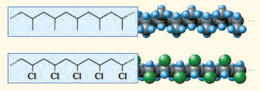

## تمرین‌های دوره‌ای

۱- در هر یک از موارد زیر ساختار پلیمر یا مونومر خواسته شده را مشخص کنید.

الف، ب) 

پ) $\mathrm{CH_3-CH_2-CH=CH_2}$

ت) $\mathrm{R_2C=CH_2}$

ث) $\mathrm{[-CH_2-C(CH_3)_2-]_n}$

۲- با توجه به ساختار مولکول‌های (۱) و (۲):

۱) $\mathrm{CH_3CH_2COOH}$

۲) $\mathrm{CH_3(CH_2)_{16}COOH}$

الف) کدام‌یک در آب محلول است؟ چرا؟

ب) پیش‌بینی کنید حالت فیزیکی کدام‌یک در دما و فشار اتاق، مایع و کدام‌یک جامد است؟ چرا؟

پ) توضیح دهید چرا ترکیب (۲) را اسید چرب می‌خوانند؟

۳- با توجه به ساختار مولکول‌های (۱) و (۲):

۱) $\mathrm{CH_3NH_2}$

۲) $\mathrm{(CH_3)_3N}$

الف) این دو ترکیب جزء کدام خانواده از ترکیب‌های آلی هستند؟

ب) کدام ترکیب توانایی تشکیل پیوند هیدروژنی دارد؟ چرا؟

پ) کدام‌یک در واکنش با کربوکسیلیک اسید برای تولید آمید، مناسب نیست؟ چرا؟

۴- برای استری با فرمول $\mathrm{C_2H_4O_2}$:

الف) ساختار آن را رسم کنید.
