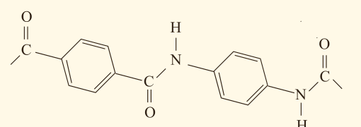

ب) ساختار الکل و اسید سازنده آن را رسم کنید.

پ) نیروی بین مولکولی را مشخص کنید.

ت) جرم مولی را حساب کنید.

ث) نقطه جوش آن را با بیان دلیل با اتانوئیک اسید مقایسه کنید.

۵- بخشی از ساختار مولکول سازنده یک پلیمر در شکل زیر ارائه شده است. با توجه به آن:

الف) این پلیمر به کدام دسته از پلیمرها تعلق دارد؟

ب) نیروی بین مولکول‌های این پلیمر از چه نوعی است؟

پ) واحدهای سازنده این پلیمر کدام گروه از مواد زیر است؟

- دی‌آمین و دی‌اسید
- دی‌الکل و دی‌اسید
- آمین و اسید

۶- واکنش پلیمری شدن اتن در شرایط گوناگونی به تولید پلی‌اتن‌هایی با جرم مولی میانگین متفاوت منجر می‌شود. تجربه نشان می‌دهد که جرم مولی میانگین به مقدار کاتالیزگرهای واکنش بستگی دارد. در جدول زیر نتایج یک پژوهش تجربی در این مورد داده شده است.

| شمار مول‌های کاتالیزگر محتوی تیتانیم (شماره ۱) | شمار مول‌های کاتالیزگر محتوی آلومینیم (شماره ۲) | جرم مولی میانگین پلیمر (گرم) |
|---|---|---|
| ۱ | ۱۲ | ۲۷۲۰۰۰ |
| ۱ | ۶ | ۲۹۲۰۰۰ |
| ۱ | ۳ | ۲۹۸۰۰۰ |
| ۱ | ۱ | ۲۸۴۰۰۰ |
| ۱ | ۰/۶۳ | ۱۶۰۰۰۰ |
| ۱ | ۰/۵۳ | ۴۰۰۰۰ |
| ۱ | ۰/۵۰ | ۲۱۰۰۰ |
| ۱ | ۰/۲۰ | ۳۱۰۰۰ |

الف) در چه نسبت مولی از این دو کاتالیزگر پلی‌اتن با بیشترین جرم مولی تولید می‌شود؟

ب) تغییر جرم مولی پلیمر را برحسب نسبت مولی کاتالیزگر شماره ۱ به ۲ رسم کنید.

پ) در نسبت مولی ۸ به ۱ از این کاتالیزگرها جرم مولی را پیش‌بینی کنید.

ت) تحلیل خود از داده‌های جدول و نمودار رسم شده را بیان کنید.
