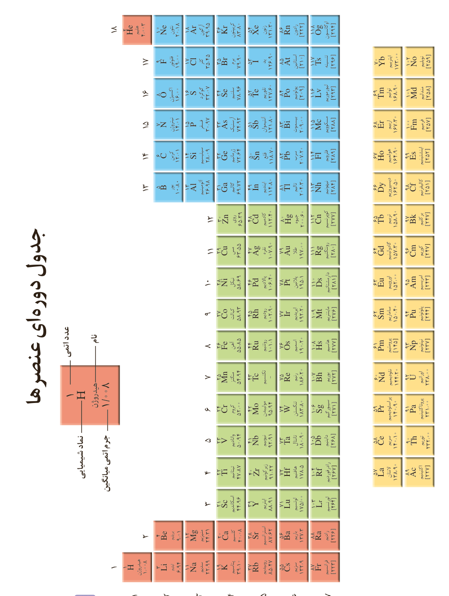

# جدول دوره‌ای عنصرها

در هر خانه: عدد اتمی، نماد شیمیایی، نام و جرم اتمی میانگین.

| دوره | عنصرها به ترتیب عدد اتمی |
|---|---|
| ۱ | H هیدروژن؛ He هلیم |
| ۲ | Li لیتیم؛ Be بریلیم؛ B بور؛ C کربن؛ N نیتروژن؛ O اکسیژن؛ F فلوئور؛ Ne نئون |
| ۳ | Na سدیم؛ Mg منیزیم؛ Al آلومینیم؛ Si سیلیسیم؛ P فسفر؛ S گوگرد؛ Cl کلر؛ Ar آرگون |
| ۴ | K پتاسیم؛ Ca کلسیم؛ Sc اسکاندیم؛ Ti تیتانیم؛ V وانادیم؛ Cr کروم؛ Mn منگنز؛ Fe آهن؛ Co کبالت؛ Ni نیکل؛ Cu مس؛ Zn روی؛ Ga گالیم؛ Ge ژرمانیم؛ As آرسنیک؛ Se سلنیم؛ Br برم؛ Kr کریپتون |
| ۵ | Rb روبیدیم؛ Sr استرانسیم؛ Y ایتریم؛ Zr زیرکونیم؛ Nb نیوبیم؛ Mo مولیبدن؛ Tc تکنسیم؛ Ru روتنیم؛ Rh رودیم؛ Pd پالادیم؛ Ag نقره؛ Cd کادمیم؛ In ایندیم؛ Sn قلع؛ Sb آنتیموان؛ Te تلوریم؛ I ید؛ Xe زنون |
| ۶ | Cs سزیم؛ Ba باریم؛ La لانتان؛ Hf هافنیم؛ Ta تانتال؛ W تنگستن؛ Re رنیم؛ Os اسمیم؛ Ir ایریدیم؛ Pt پلاتین؛ Au طلا؛ Hg جیوه؛ Tl تالیم؛ Pb سرب؛ Bi بیسموت؛ Po پولونیم؛ At استاتین؛ Rn رادون |
| ۷ | Fr فرانسیم؛ Ra رادیم؛ Ac اکتینیم؛ Rf رادرفوردیم؛ Db دوبنیم؛ Sg سیبورگیم؛ Bh بوریم؛ Hs هاسیم؛ Mt مایتنریم؛ Ds دارمشتاتیم؛ Rg رونتگنیم؛ Cn کوپرنیکیم؛ Nh نیهونیم؛ Fl فلروویم؛ Mc مسکوویم؛ Lv لیورموریم؛ Ts تنسین؛ Og اوگانسون |
| لانتانیدها | La، Ce، Pr، Nd، Pm، Sm، Eu، Gd، Tb، Dy، Ho، Er، Tm، Yb، Lu |
| اکتینیدها | Ac، Th، Pa، U، Np، Pu، Am، Cm، Bk، Cf، Es، Fm، Md، No، Lr |
