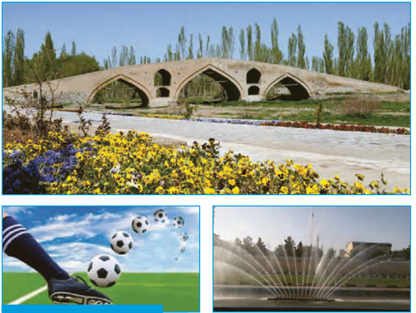

# فصل ۱ ـ هندسۀ تحلیلی و جبر

پل میر بهاءالدین بر روی رودخانۀ زنجان‌رود

مسیر حرکت برخی از پرتابه‌ها را به کمک توابع درجه دوم می‌توان نمایش داد. با دقت در محیط پیرامون خود، پدیده‌هایی را بیابید که با توابع درجه ۲ مرتبط باشند.

- درس اول: هندسۀ تحلیلی
- درس دوم: معادلۀ درجۀ دوم و تابع درجۀ ۲
- درس سوم: معادلات گویا و معادلات رادیکالی
