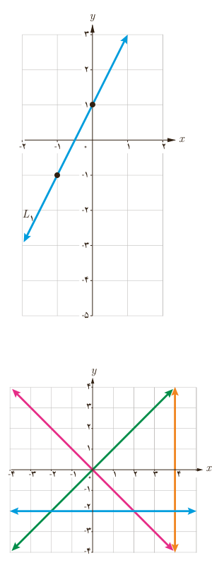

# درس اول ـ هندسۀ تحلیلی
## یادآوری و تکمیل معادلۀ خط

در بسیاری از پدیده‌های جهان، رابطۀ خطی بین متغیرها به چشم می‌خورد. بنابراین مطالعۀ تابع‌های خطی اهمیت ویژه‌ای پیدا می‌کند. در سال‌های قبل با مطالبی در این زمینه آشنا شدیم. در این درس نکات دیگری را در این باره، مورد مطالعه قرار می‌دهیم.

## کار در کلاس

۱. به‌طور شهودی می‌توان دید که از هر دو نقطۀ متمایز، تنها یک خط عبور می‌کند؛ بنابراین:

الف) با داشتن مختصات .... نقطه از یک خط باید بتوان معادلۀ آن را به دست آورد.

ب) با داشتن معادلۀ یک خط می‌توان با مشخص کردن .... نقطه از خط، نمودار آن را در دستگاه مختصات رسم کرد.

۲. نمودار خطوط با معادلات زیر را در دستگاه مختصات مشخص شده، رسم کنید:

الف) $L_1:y=2x+1$

| $x$ | $-1$ | $0$ |
|---|---|---|
| $y$ | $-1$ | $1$ |

ب) $L_2:y=2x-3$  
پ) $L_3:y=1$  
ت) $L_4:x=-2$  
ث) $L_5:x+2y=2$

۳. معادلۀ هر یک از خط‌های نمایش داده شده روی شکل را بنویسید.

۴. الف) می‌دانیم که شیب یک خط برابر است با نسبت جابه‌جایی عمودی به جابه‌جایی .... ؛ به عبارت دیگر شیب خط گذرا از دو نقطۀ غیر هم‌طول $A$ و $B$ برابر است با:

$$m_{AB}=\frac{\ldots}{x_B-x_A}$$

ب) شرط موازی بودن دو خط آن است که دارای .... برابر باشند.

