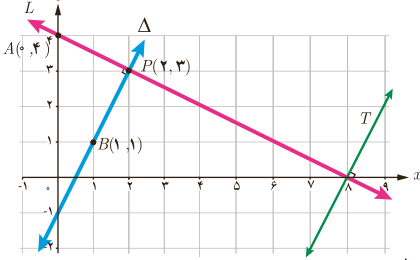

۵. الف) از پایۀ نهم به خاطر داریم که هرگاه خط $L$ محور $y$ها را در نقطه‌ای با عرض $h$ قطع کند، آن‌گاه $h$، .... خط $L$ نامیده می‌شود.

ب) در سؤال ۲، شیب و عرض از مبدأ هر یک از پنج خط ذکر شده را بنویسید. در این سؤال کدام دو خط با هم موازی‌اند؟

۶. الف) خط با شیب $m$ و عرض از مبدأ $h$ معادله‌ای به صورت $y=\ldots$ دارد.

ب) می‌خواهیم معادلۀ خط $L$، گذرا از دو نقطۀ $A(0,7)$ و $B(3,1)$ را بنویسیم. برای این کار، ابتدا شیب خط را محاسبه می‌کنیم:

$$m=\frac{y_B-y_A}{x_B-x_A}=\frac{1-7}{3-0}=-2$$

معادلۀ خط: $y=-2x+h$

$B(3,1)$ روی خط $L$ واقع است: $1=-2(3)+h\Rightarrow h=7$

البته اگر به مختصات نقطۀ $A(0,7)$ از خط $L$ دقت کنیم، بدون محاسبه متوجه می‌شویم که عرض از مبدأ این خط $h=7$ است. پس:

معادلۀ خط $L$: $y=-2x+7$

پ) معادلۀ خط گذرنده از نقطۀ $P(2,-1)$ را بنویسید؛ به‌طوری که با خط $y=3x-4$ موازی باشد.

## فعالیت

۱. دو خط $L$ و $\Delta$ را عمود بر هم رسم کرده‌ایم. به شیب‌های این دو خط توجه می‌کنیم:

شیب خط $L$ گذرا از نقاط $A$ و $P$: $m=\frac{y_P-y_A}{x_P-x_A}=\frac{3-4}{2-0}=-\frac12$

شیب خط $\Delta$ گذرا از نقاط $B$ و $P$: $m'=\ldots$

۲. حاصل‌ضرب شیب‌های دو خط را به دست می‌آوریم: $mm'=(-\frac12)(\ldots)=\ldots$. می‌بینیم که شیب‌ها، قرینۀ معکوس یکدیگرند.

۳. اگر خط دلخواه دیگری مثل $T$ عمود بر $L$ را در نظر بگیریم، این خط حتماً با خط $\Delta$ .... است؛ پس شیب خط $T$ برابر عدد .... خواهد بود. بنابراین می‌توان گفت شیب هر خط عمود بر $L$ برابر قرینۀ .... شیب خط $L$ خواهد بود. این مطلب در حالت کلی درست است؛ یعنی:

دو خط غیر موازی با محورهای مختصات بر هم عمودند، هرگاه حاصل‌ضرب شیب‌های آنها برابر $-1$ باشد؛ یعنی اگر شیب‌های دو خط $m$ و $m'$ باشد، آنگاه شرط عمود بودن آنها آن است که $mm'=-1$. به عبارت دیگر شیب هرکدام، قرینۀ معکوس شیب دیگری باشد.

۱ـ راه‌های اثبات مختلفی برای این مطلب وجود دارد که یکی از آنها به کمک قضیۀ فیثاغورس است.
