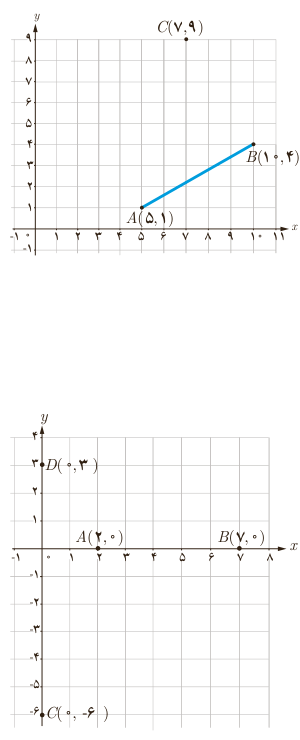

## کار در کلاس

۱. در هر قسمت شیب دو خط داده شده را به دست آورید و مشخص کنید که دو خط نسبت به هم چه وضعی دارند. (موازی، عمود یا متقاطع غیر عمود؟)

الف) $L:y=5x-2$، $T:y=-\frac15x+3$  
ب) $L:y=\frac12x+7$، $T:x-2y=1$  
پ) $L:2x-3y+3=0$، $T:3x+2y=0$  
ت) $L:x=1$، $T:y=-3$  
ث) $L:y=3x+1$، $T:x=3y-1$

۲. خط $L$ به معادلۀ $2y-3x=1$ و خط $T$ با عرض از مبدأ ۵ به معادلۀ $y=mx+5$ را در نظر بگیرید.

الف) $m$ را طوری بیابید که خط $T$ با خط $L$ موازی باشد.

ب) به ازای چه مقداری از $m$، دو خط بر یکدیگر عمودند؟

۳. مربع $ABCD$ در ناحیۀ اول صفحۀ مختصات واقع است، به طوری که $A(5,1)$ و $B(10,4)$ دو رأس مجاور آن هستند.

الف) شیب ضلع $AB$ را بنویسید.

ب) شیب ضلع $AD$ را حساب کنید و معادلۀ این ضلع را بنویسید.

پ) اگر بدانیم نقطۀ $C(7,9)$ رأس سوم مربع است، مختصات رأس $D$ را بیابید.

ت) مربع را به‌طور کامل رسم کنید.

## فاصلۀ دو نقطه
### فعالیت

در این دستگاه مختصات:

الف) فاصله دو نقطۀ $A$ و $B$ که برابر طول پاره‌خط $AB$ است، برابر ۵ است. چه رابطه‌ای بین این عدد با $x_A$ و $x_B$ وجود دارد؟

ب) فاصلۀ دو نقطۀ $C$ و $D$ را برحسب عرض آنها بیان کنید.
