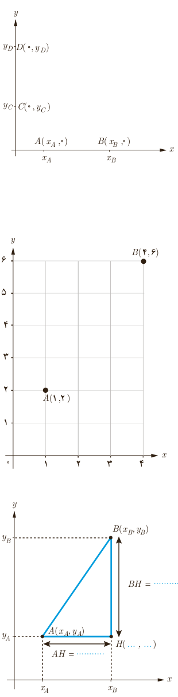

پ) در شکل مقابل، فاصلۀ نقاط $A$ و $B$ را برحسب طول آنها و فاصلۀ دو نقطۀ $C$ و $D$ را برحسب عرض آنها به‌دست آورید.

$$AB=\qquad CD=$$

در حالت کلی می‌توان گفت:

۱ـ اگر $A$ و $B$ دو نقطۀ هم‌عرض در صفحه باشند، آن‌گاه $AB=|x_A-x_B|$.

۲ـ اگر $C$ و $D$ دو نقطۀ هم‌طول در صفحه باشند، آن‌گاه $CD=|y_C-y_D|$.

## فعالیت

۱. در شکل مقابل فاصلۀ دو نقطۀ $A$ و $B$ را با خط‌کش به‌دست آورید.

۲. بدون استفاده از خط‌کش، طول پاره‌خط $AB$ را به‌دست آورید. برای این کار از چه رابطه‌ای استفاده می‌کنید؟

۳. در شکل مقابل:

الف) مختصات نقطۀ $H$ را بنویسید.

ب) طول پاره‌خط‌های $AH$ و $BH$ را مشخص کنید و روی شکل بنویسید.

پ) طول $AB$ را به کمک قضیۀ فیثاغورس به‌دست آورید.

با توجه به فعالیت قبل می‌توان گفت:

فاصلۀ دو نقطۀ $A(x_A,y_A)$ و $B(x_B,y_B)$ برابر است با:

$$AB=\sqrt{(x_A-x_B)^2+(y_A-y_B)^2}$$
