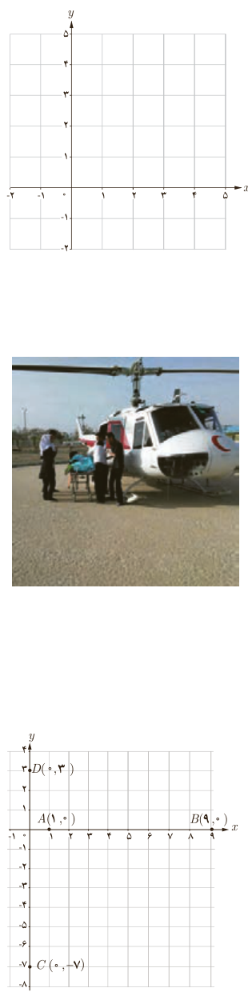

## کار در کلاس

۱. نقاط $A(2,0)$، $B(5,4)$ و $C(-2,3)$ را در نظر بگیرید و آنها را روی دستگاه مختصات مشخص کنید.

الف) محیط مثلث $ABC$ را با محاسبۀ طول اضلاع آن به دست آورید.

$$AB=\sqrt{(x_A-x_B)^2+(y_A-y_B)^2}=\sqrt{(2-5)^2+(0-4)^2}=\sqrt{9+16}=5$$

$AC=\ldots$، $BC=\ldots$، محیط: $P=\ldots$

ب) $ABC$ چه نوع مثلثی است؟

پ) به دو روش نشان دهید $ABC$ یک مثلث قائم‌الزاویه است. سپس مساحت آن را حساب کنید.

۲. در یکی از جاده‌های کشور، تصادفی رخ داده است که مختصات نقطۀ تصادف روی نقشۀ مرکز امداد به صورت $P(50,30)$ است. پایگاه‌های امداد هوایی که به محل تصادف نزدیک‌اند، در نقاط $A(10,-20)$ و $B(80,90)$ واقع‌اند. شما کدام پایگاه را برای اعزام بالگرد امداد به محل حادثه پیشنهاد می‌کنید؟ (اعداد برحسب کیلومتر هستند).

۳. الف) فاصلۀ نقطۀ $N(-6,8)$ تا مبدأ مختصات را محاسبه کنید.

ب) فاصلۀ نقطۀ $E(x_E,y_E)$ تا مبدأ مختصات را به دست آورید.

## مختصات نقطۀ وسط پاره‌خط
### فعالیت

در این دستگاه مختصات:

الف) نقطۀ وسط پاره‌خط $AB$ را $M$ بنامید و $M$ را به همراه مختصات آن روی شکل مشخص کنید.

ب) نقطۀ وسط پاره‌خط $CD$ را $N$ بنامید و $N$ را به همراه مختصات آن روی شکل مشخص کنید.

