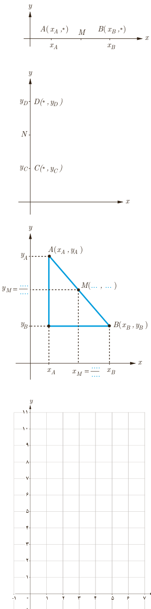

پ) مطابق شکل، $A$ و $B$ دو نقطۀ دلخواه روی محور $x$ها هستند. اگر $M$ وسط $AB$ باشد، طول نقطۀ $M$ را به دست آورید.

$$M\text{ وسط }AB\Rightarrow AM=MB\Rightarrow x_M-x_A=\ldots\Rightarrow 2x_M=\ldots\Rightarrow x_M=\frac{x_A+x_B}{\ldots}$$

ت) در شکل مقابل، $C$ و $D$ دو نقطۀ دلخواه روی محور $y$ها هستند. اگر $N$ وسط $CD$ باشد، عرض نقطۀ $N$ را بیابید.

$$N\text{ وسط }CD\Rightarrow\ldots\Rightarrow y_N=\frac{\ldots}{2}$$

ث) اگر $A$ و $B$ دو نقطۀ دلخواه در صفحۀ مختصات باشند و $M$ نقطۀ وسط $AB$، آنگاه با توجه به شکل مقابل می‌توان نشان داد:

مختصات نقطۀ وسط پاره‌خط $AB$ عبارت است از:

$$M\left(\frac{x_A+x_B}{2},\frac{y_A+y_B}{2}\right)$$

## کار در کلاس

۱. مثلث با رأس‌های $A(1,9)$، $B(3,1)$ و $C(7,11)$ را در نظر بگیرید و آن را در دستگاه مختصات مقابل مشخص کنید.

الف) مختصات $M$، نقطۀ وسط ضلع $BC$ را مشخص کنید.

ب) طول میانۀ $AM$ را محاسبه کنید.

پ) معادلۀ خطی که میانۀ $AM$ روی آن قرار دارد را به دست آورید.

۲. الف) نقطۀ $N(5,-4)$ وسط پاره‌خط واصل بین دو نقطۀ $A$ و $B(7,-2)$ است. مختصات نقطۀ $A$ را بیابید.

ب) قرینۀ نقطۀ $C(1,2)$ نسبت به نقطۀ $M(-1,4)$ را به دست آورید.

پ) قرینۀ نقطۀ $P(\alpha,\beta)$ نسبت به مبدأ مختصات را به دست آورید.
