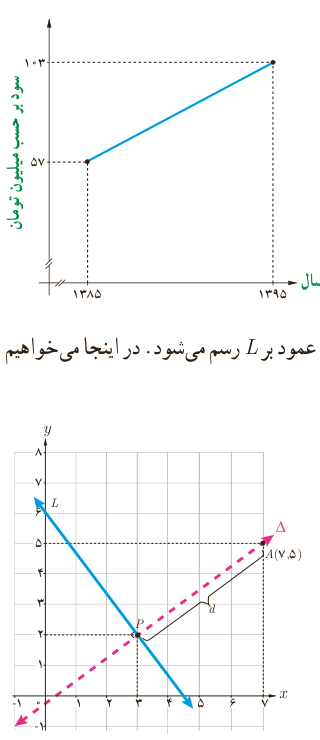

۳. سود سالانۀ یک کارگاه کوچک تولیدی از سال ۱۳۸۵ تا ۱۳۹۵ طبق نمودار مقابل سیر صعودی داشته است. به کمک رابطۀ نقطۀ وسط پاره‌خط، به سؤالات زیر پاسخ دهید:

الف) میانگین سود سالانۀ این شرکت در دهۀ مورد نظر چقدر بوده است؟

ب) در کدام سال، مقدار سود سالانه، با این میانگین سود ده ساله برابر بوده است؟

پ) اگر سود سالانه در طول یک دهۀ آینده با همین روند افزایش یابد، انتظار می‌رود در سال ۱۴۰۵ سود سالانۀ شرکت چقدر باشد؟

## فاصلۀ نقطه از خط

اگر $A$ نقطه‌ای خارج خط $L$ باشد، فاصلۀ نقطۀ $A$ تا خط $L$ برابر است با طول پاره‌خطی که از $A$ عمود بر $L$ رسم می‌شود. در اینجا می‌خواهیم با داشتن مختصات نقطۀ $A$ و معادلۀ خط $L$ این فاصله را محاسبه کنیم.

مثال: فاصلۀ نقطۀ $A(7,5)$ را از خط $L$ به معادلۀ $4x+3y=18$ به دست آورید.

حل: چون شیب خط $L$ برابر $-\frac43$ است، پس هر خط عمود بر آن دارای شیب $\frac34$ خواهد بود. معادلۀ خط $\Delta$ گذرنده از $A$ و عمود بر $L$ را می‌نویسیم:

$$\Delta:y=\frac34x+h$$

$A(7,5)$ روی $\Delta$ است: $5=\frac34(7)+h\Rightarrow h=-\frac14$

معادلۀ $\Delta$: $y=\frac34x-\frac14\Rightarrow\Delta:3x-4y=1$

اگر معادلۀ دو خط $L$ و $\Delta$ را به صورت یک دستگاه معادلات خطی در نظر بگیریم، از حل آن مختصات نقطۀ $P$، محل برخورد دو خط به دست می‌آید:

$$\begin{cases}4x+3y=18\\3x-4y=1\end{cases}\Rightarrow x=3,\ y=2\Rightarrow P(3,2)$$

طول پاره‌خط $AP$ جواب مسئله است.

$$AP=\sqrt{(x_A-x_P)^2+(y_A-y_P)^2}=\sqrt{(7-3)^2+(5-2)^2}=\sqrt{16+9}=5$$

با به‌کارگیری مراحل حل این مثال در حالت کلی می‌توان ثابت کرد¹:

فاصلۀ نقطۀ $A(x_0,y_0)$ از خط به معادلۀ $ax+by+c=0$ برابر است با:

$$d=\frac{|ax_0+by_0+c|}{\sqrt{a^2+b^2}}$$

حال مثال قبل را به کمک این رابطه حل می‌کنیم؛ یعنی فاصلۀ $A(7,5)$ را از خط به معادلۀ $4x+3y-18=0$ به دست می‌آوریم:

$$d=\frac{|4(7)+3(5)-18|}{\sqrt{4^2+3^2}}=\frac{|25|}{5}=5$$

۱ـ ارائۀ اثبات این فرمول در کلاس، مورد نظر نمی‌باشد.
