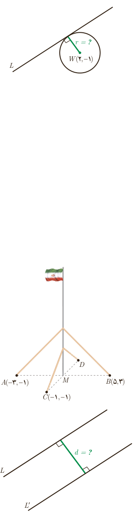

## کار در کلاس

۱. فاصلۀ نقطۀ $P(7,-4)$ را از هر یک از خطوط با معادله‌های زیر به‌دست آورید:

الف) $L:2x+y=5$؛ ب) $T:x=5$؛ پ) $\Delta:y=0$

۲. خط $L:3x-4y=0$ بر دایره‌ای به مرکز $W(2,-1)$ مماس است. شعاع دایره را بیابید. (راهنمایی: خط مماس بر دایره بر شعاع گذرنده از نقطۀ تماس عمود است.)

## تمرین

۱. وضعیت هر جفت از خطوط زیر را نسبت به هم مشخص کنید:

$L:2x-y=1$، $T:y=2x-3$، $\Delta:x+2y=0$

۲. دو نقطۀ $A(14,3)$ و $B(10,-13)$ را در نظر بگیرید. فاصلۀ مبدأ مختصات را از وسط پاره‌خط $AB$ به‌دست آورید.

۳. نشان دهید مثلث با رأس‌های $A(1,2)$، $B(2,5)$ و $C(4,1)$ یک مثلث متساوی‌الساقین قائم‌الزاویه است.

۴. دو انتهای یکی از قطرهای دایره‌ای نقاط $A(2,-2)$ و $B(6,4)$ هستند.

الف) اندازۀ شعاع و مختصات مرکز دایره را بیابید.

ب) آیا نقطۀ $C(7,3)$ بر روی محیط این دایره قرار دارد؟ چرا؟

۵. نقاط $A(2,3)$، $B(-1,0)$ و $C(1,-2)$ سه رأس از مستطیل $ABCD$ هستند. مختصات رأس چهارم آن را بیابید. (با دانستن این مطلب که در هر مستطیل، قطرها منصف یکدیگرند، آیا می‌توانید راه‌حل کوتاه‌تری برای مسئله ارائه کنید؟)

۶. یک میلۀ پرچم بزرگ، مطابق شکل توسط کابل‌هایی به چهار نقطه در زمین محکم شده است؛ به طوری که فاصلۀ هر یک از چهار نقطه تا پای میله برابر است با فاصلۀ نقطۀ مقابل آن تا پای میله. مختصات نقطۀ $D$ را به‌دست آورید.

۷. یکی از اضلاع مربعی بر خط $L:y=2x-1$ واقع است. اگر $A(3,0)$ یکی از رئوس این مربع باشد، مساحت آن را به دست آورید.

۸. الف) نشان دهید دو خط با معادلات $5x-12y+8=0$ و $-10x+24y+10=0$ با یکدیگر موازی‌اند.

ب) فاصلۀ این دو خط را محاسبه کنید. (راهنمایی: یک نقطۀ دلخواه روی یکی از خطوط در نظر بگیرید و فاصلۀ آن را از خط دیگر به دست آورید.)

