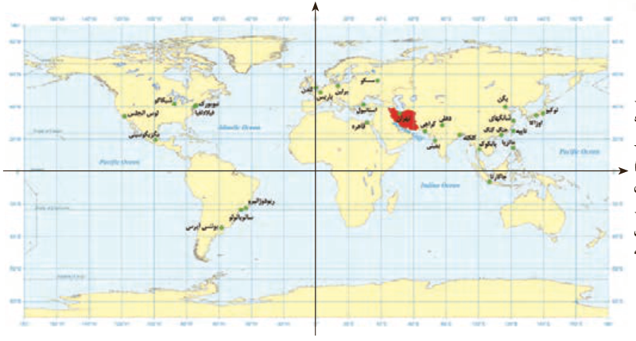

۹. طول جغرافیایی تبریز تقریباً ۴۶ درجۀ شرقی و عرض جغرافیایی آن حدود ۳۸ درجۀ شمالی است. برای راحتی، می‌توانیم موقعیت این شهر را به‌طور خلاصه، به صورت $(46,38)$ نشان دهیم. این اطلاعات دربارۀ چابهار به صورت $(61,25)$ است. با فرض اینکه مسافت فیزیکی هر درجه طول جغرافیایی همانند مسافت فیزیکی هر درجه عرض جغرافیایی برابر ۱۱۰ کیلومتر باشد، مطلوب است محاسبۀ فاصلۀ تقریبی این دو شهر.

آیا تاکنون به رابطۀ طول و عرض جغرافیایی با دستگاه مختصات فکر کرده‌اید؟ در دستگاه مختصات مقابل، کدام محور نظیر طول جغرافیایی است؟ با توجه به طول و عرض جغرافیایی چابهار، محل تقریبی این شهر را روی نقشه مشخص کنید.

موزۀ قاجار تبریز
