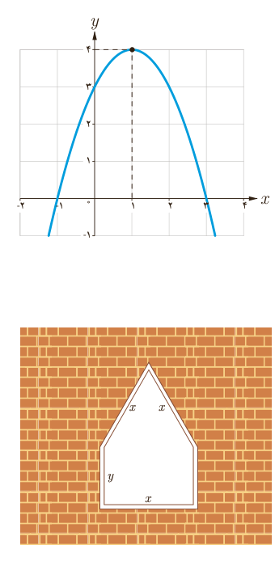

## ماکزیمم و مینیمم تابع درجۀ دوم

سهمی با ضابطۀ $y=ax^2+bx+c$ را در نظر می‌گیریم. از سال گذشته می‌دانیم که طول رأس این سهمی $x=-\frac b{2a}$ است.

الف) اگر $a>0$، آنگاه دهانۀ سهمی رو به بالاست و به ازای $x=-\frac b{2a}$ کمترین (مینیمم) مقدار تابع درجۀ دوم موردنظر به‌دست می‌آید.

ب) اگر $a<0$، آنگاه دهانۀ سهمی رو به پایین است و به ازای $x=-\frac b{2a}$ بیشترین (ماکزیمم) مقدار تابع درجۀ دوم موردنظر حاصل می‌شود.

مثال: ماکزیمم یا مینیمم تابع با ضابطۀ $f(x)=-x^2+2x+3$ را در صورت وجود به‌دست آورید.

حل: چون $a=-1$ منفی است، پس دهانۀ سهمی رو به پایین است و این سهمی ماکزیمم دارد. این تابع به ازای $x=-\frac b{2a}=1$ بیشترین مقدار خود را خواهد داشت که برابر است با $f(1)=4$.

تذکر: همچنان که در شکل دیده می‌شود، در این مثال نقطۀ $(1,4)$ رأس سهمی و نقطۀ ماکزیمم آن است. در این حالت منظور از مقدار ماکزیمم سهمی، عرض این نقطه، یعنی ۴ است.

مثال: یک پنجره به شکل مستطیلی است که در بالای آن یک مثلث متساوی‌الاضلاع قرار گرفته است. اگر محیط پنجره $4m$ باشد، ابعاد مستطیل را طوری بیابید که پنجره حداکثر نوردهی را داشته باشد.

حل: با توجه به شکل داریم: $3x+2y=4\Rightarrow y=2-\frac32x$.

در کلاس دهم دیدیم که مساحت مثلث $ABC$ از رابطۀ $S=\frac12 AB\times BC\times\sin B$ به‌دست می‌آید. بنابراین مساحت مثلث متساوی‌الاضلاع به ضلع $x$ برابر $\frac{\sqrt3}{4}x^2$ است. (چرا؟) پس:

$$S=xy+\frac{\sqrt3}{4}x^2$$

به‌جای $y$ معادل آن را برحسب $x$ قرار می‌دهیم:

$$S=x(2-\frac32x)+\frac{\sqrt3}{4}x^2=\frac{\sqrt3-6}{4}x^2+2x$$

این تابع دارای ماکزیمم است (چرا؟) و بیشترین مقدار آن به ازای $x=-\frac b{2a}$ حاصل می‌شود.

$$x=\frac4{6-\sqrt3}\simeq0.94(m),\qquad y=2-\frac32x\simeq0.59(m)$$

