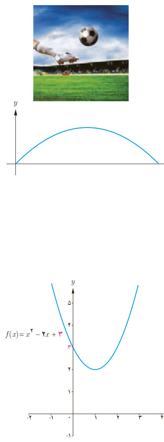

## کار در کلاس

۱. تعیین کنید کدام یک از سهمی‌های زیر ماکزیمم و کدام یک مینیمم دارند. سپس مقدار ماکزیمم یا مینیمم هر یک را مشخص کنید.

الف) $g(x)=-(x+1)^2+3$؛ ب) $h(x)=x^2-4x+9$

۲. قرار است در کنار یک رودخانه، محوطه‌ای مستطیل شکل ایجاد کنیم. برای این کار لازم است سه ضلع محوطه نرده‌کشی شود. اگر تنها هزینۀ نصب ۱۰۰ متر نرده را در اختیار داشته باشیم، ابعاد مستطیل را طوری تعیین کنید که مساحت آن بیشترین مقدار ممکن گردد.

رودخانۀ قزل‌اوزن، شاخۀ اصلی سفیدرود

## صفرهای تابع درجه ۲

همان‌گونه که می‌دانیم، نمودار هر تابع درجه دوم، یک سهمی است. به عنوان مثال فرض کنیم فوتبالیستی توپی را با زاویۀ $45^\circ$ نسبت به سطح زمین و با سرعت اولیۀ $20\,m/s$ شوت کند. معادلۀ مسیر حرکت این توپ، یک تابع درجه دو با ضابطۀ $y=-\frac1{40}x^2+x$ است که نمودار آن مانند شکل مقابل است. در این رابطه $x$ مسافت افقی طی شده و $y$ ارتفاع توپ از سطح زمین است.

الف) حداکثر ارتفاع توپ را به‌دست آورید.

ب) به نظر شما حداکثر مسافت افقی طی شده توسط توپ چقدر است؟

برای آنکه طول نقاط برخورد نمودار این تابع با محور $x$ها را به‌دست آوریم، باید قرار دهیم $y=0$:

$$y=0\Rightarrow x(-\frac1{40}x+1)=0\Rightarrow\begin{cases}x=0\\x=40\end{cases}$$

این نقاط را روی نمودار نشان دهید و توضیح دهید که این اعداد از نظر فیزیکی چه معنایی می‌دهند.

نقاط برخورد نمودار یک تابع مانند $f$ با محور $x$ها را صفرهای تابع می‌نامیم که در واقع ریشه‌های معادلۀ $f(x)=0$ هستند. به عبارت دیگر، در این نقاط، مقدار تابع برابر صفر است.

همچنین عرض نقطۀ برخورد نمودار هر تابع مثل $f$ با محور $y$ها، همان $f(0)$ است. به عبارت دیگر در تابع درجه ۲ با ضابطۀ $f(x)=ax^2+bx+c$، عدد ثابت $c$ نشان‌دهندۀ محل برخورد نمودار آن با محور $y$هاست. به عنوان مثال، به شکل مقابل توجه کنید.

