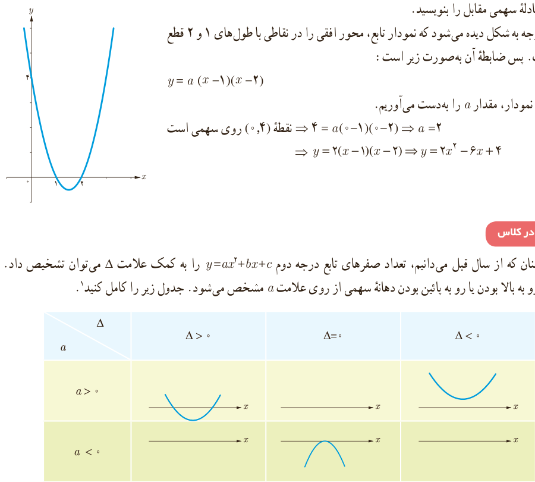

مثال: معادلۀ سهمی مقابل را بنویسید.

حل: با توجه به شکل دیده می‌شود که نمودار تابع، محور افقی را در نقاطی با طول‌های ۱ و ۲ قطع کرده است. پس ضابطۀ آن به‌صورت زیر است:

$$y=a(x-1)(x-2)$$

با توجه به نمودار، مقدار $a$ را به‌دست می‌آوریم.

نقطۀ $(0,4)$ روی سهمی است: $4=a(0-1)(0-2)\Rightarrow a=2$

$$y=2(x-1)(x-2)\Rightarrow y=2x^2-6x+4$$

## کار در کلاس

۱. همچنان که از سال قبل می‌دانیم، تعداد صفرهای تابع درجه دوم $y=ax^2+bx+c$ را به کمک علامت $\Delta$ می‌توان تشخیص داد. همچنین رو به بالا بودن یا رو به پایین بودن دهانۀ سهمی از روی علامت $a$ مشخص می‌شود. جدول زیر را کامل کنید.¹

| $a$ / $\Delta$ | $\Delta>0$ | $\Delta=0$ | $\Delta<0$ |
|---|---|---|---|
| $a>0$ | سهمی رو به بالا، دو برخورد |  | سهمی رو به بالا، بدون برخورد |
| $a<0$ |  | سهمی رو به پایین، مماس |  |

۲. دربارۀ تابع درجه دوم $f$، برای تشخیص علامت ریشه‌های احتمالی معادلۀ $f(x)=0$ می‌توانیم از علامت $S$ و $P$ کمک بگیریم. در هر یک از موارد زیر، مانند قسمت الف عمل کنید.

الف) $y=x^2+6x+5$

$\Delta=16>0\Rightarrow$ معادلۀ $y=0$ دو ریشۀ حقیقی متمایز دارد.

$P=\frac ca=5>0\Rightarrow$ ریشه‌ها هم‌علامت‌اند.

$S=-\frac ba=-6<0\Rightarrow$ هر دو ریشه منفی‌اند.

ب) $y=x^2+4x-5$؛ پ) $y=3x^2-7x+1$؛ ت) $y=-x^2+2x-1$

۱ـ در این جدول محور $y$ها رسم نشده است.

