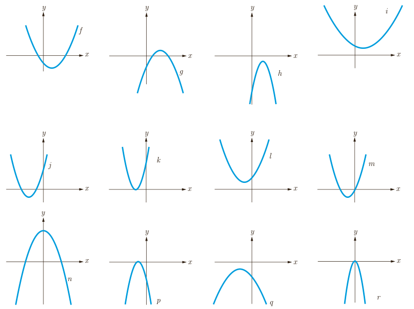

۳. هرگاه نمودار تابع $f(x)=ax^2+bx+c$ ($a\ne0$) را داشته باشیم، می‌توانیم به کمک آن، علامت ضرایب $a$، $b$ و $c$ را مشخص کنیم. به عنوان مثال نمودار تابع $f$ از مجموعۀ توابع داده شده زیر را در نظر می‌گیریم:

- دهانۀ سهمی رو به بالاست؛ پس $a$ مثبت است.
- نمودار تابع $f$ محور $y$ها را در قسمت منفی‌ها قطع کرده است؛ پس $c$ منفی است.
- رأس سهمی در ربع چهارم قرار گرفته که در آن مقادیر $x$ مثبت‌اند؛ پس: $-\frac b{2a}>0\Rightarrow b<0$.

توجه داریم که باتوجه به نمودار، مجموع دو ریشه، عددی مثبت است (چرا؟) و از این مطلب هم می‌توان منفی بودن علامت $b$ را نتیجه گرفت.

خلاصۀ این اطلاعات در جدول بعد آمده است. جدول را کامل کنید.

| ویژگی / تابع | $f$ | $g$ | $h$ | $i$ | $j$ | $k$ | $l$ | $m$ | $n$ | $p$ | $q$ | $r$ |
|---|---|---|---|---|---|---|---|---|---|---|---|---|
| علامت $a$ | + | | | | | | | + | | | − | |
| علامت $b$ | − | | | | | | | + | | | − | |
| علامت $c$ | − | | | | | | | ۰ | | | − | |
| تعداد ریشه‌های متمایز | دو | | | | | | | دو | | | صفر | |
| علامت ریشه یا ریشه‌ها (در صورت وجود) | یکی منفی، یکی مثبت | | | | | | | یکی منفی، یکی صفر | | | ریشه ندارد | |
