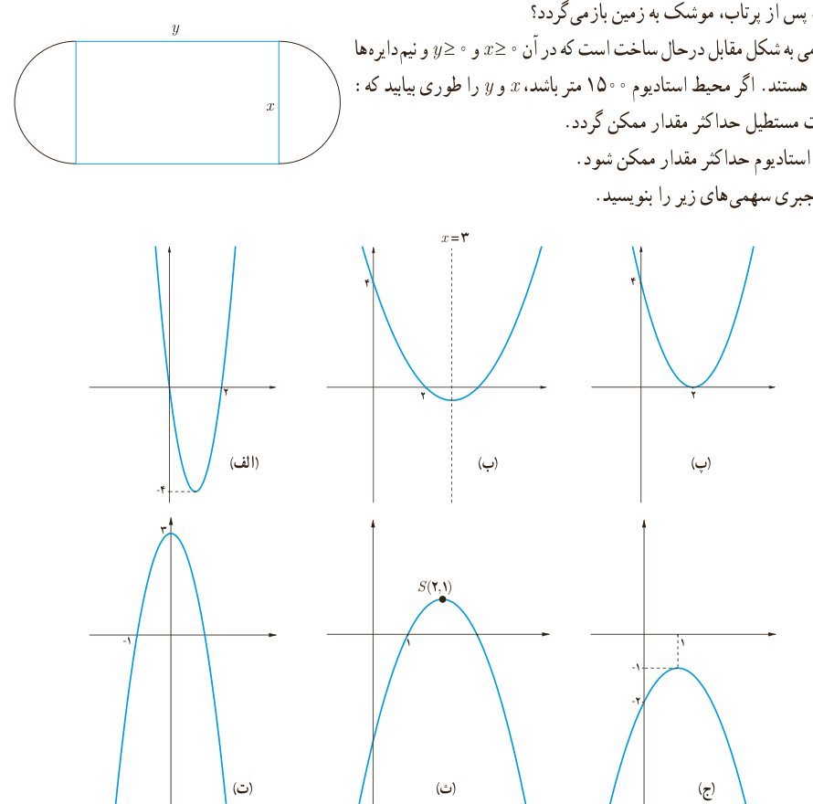

## تمرین

۱. معادله‌های زیر را حل کنید.

الف) $x^4-8x^2+8=0$؛ ب) $4x^6+1=5x^3$

۲. معادلۀ درجۀ دومی بنویسید که ریشه‌های آن $1-\sqrt2$ و $1+\sqrt2$ باشند.

۳. مقدار ماکزیمم یا مینیمم توابع با ضابطه‌های زیر را به دست آورید.

الف) $f(x)=-2x^2+8x-5$؛ ب) $g(x)=3x^2+6x+5$

۴. موشکی که به‌طور عمودی رو به بالا شلیک شده، $t$ ثانیه پس از پرتاب در ارتفاع $h$ متری از سطح زمین قرار می‌گیرد که معادلۀ آن به صورت مقابل است: $h(t)=100t-5t^2$، $(t\ge0)$.

الف) چقدر طول می‌کشد تا موشک به بالاترین ارتفاع ممکن خود برسد؟

ب) ارتفاع نقطۀ اوج را بیابید.

پ) چند ثانیه پس از پرتاب، موشک به زمین بازمی‌گردد؟

۵. استادیومی به شکل مقابل در حال ساخت است که در آن $x\ge0$ و $y\ge0$ و نیم‌دایره‌ها به شعاع $\frac x2$ هستند. اگر محیط استادیوم ۱۵۰۰ متر باشد، $x$ و $y$ را طوری بیابید که:

الف) مساحت مستطیل حداکثر مقدار ممکن گردد.

ب) مساحت استادیوم حداکثر مقدار ممکن شود.

۶. ضابطۀ جبری سهمی‌های زیر را بنویسید.

