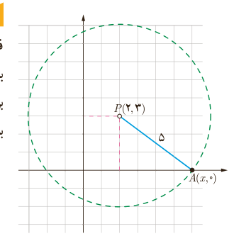

## معادلات رادیکالی

فرض کنید بخواهیم نقطه‌ای را روی محور $x$ها بیابیم که فاصلۀ آن از نقطۀ $P(2,3)$ برابر ۵ باشد. مسئله چند جواب دارد؟

برای این کار فرض می‌کنیم مختصات نقطۀ مورد نظر به‌صورت $A(x,0)$ باشد. مقدار $x$ را به‌دست می‌آوریم.

$$AP=\sqrt{(x_A-x_P)^2+(y_A-y_P)^2}=\sqrt{(x-2)^2+(0-3)^2}$$
$$(3)\quad AP=5\Rightarrow\sqrt{(x-2)^2+9}=5$$

معادلاتی مانند (۳) که در آن عبارت رادیکالی شامل مجهول وجود دارد، یک معادلۀ رادیکالی نامیده می‌شود.¹

برای حل یک معادلۀ رادیکالی می‌توان جملات را طوری در طرفین تساوی جابه‌جا کرد که یک عبارت رادیکالی به تنهایی در یک طرف تساوی قرار گیرد. سپس با به توان رساندن طرفین معادله و در صورت لزوم با تکرار این عمل، معادله را از شکل رادیکالی خارج کرد. پس از حل معادله باید مطمئن شویم که جواب‌های حاصل در معادلۀ اولیه صدق می‌کنند.

برای حل معادلۀ (۳) در بالا، اگر طرفین تساوی را به توان دو برسانیم، خواهیم داشت:

$$(x-2)^2+9=25\Rightarrow(x-2)^2=16\Rightarrow\begin{cases}x-2=4\Rightarrow x=6\Rightarrow A(6,0)\\x-2=-4\Rightarrow x=-2\Rightarrow B(-2,0)\end{cases}$$

تذکر: عبارت رادیکالی معادلۀ (۳) همواره با معناست؛ چون در آن، حاصل زیر رادیکال همواره مثبت است. در این حالت می‌گوییم دامنۀ متغیر برابر $\mathbb R$ است و می‌توانیم بنویسیم $D=(-\infty,+\infty)$.

مثال: در معادلۀ $2\sqrt{x}=\sqrt{3x-3}$، دامنۀ متغیر به‌صورت $D=[1,+\infty)$ است (چرا؟). با به توان رساندن دو طرف معادله داریم:

$$4x=3x-3\Rightarrow x=-3\quad\text{(غیر قابل قبول)}$$

چون جواب به دست آمده خارج از دامنۀ متغیر است، قابل قبول نیست. شایان ذکر است که جواب‌های درون دامنه نیز به شرطی مورد قبول‌اند که در معادلۀ اصلی صدق کنند.

۱ـ در این کتاب، تنها معادلات رادیکالی با فرجۀ ۲ مورد بحث قرار می‌گیرند.

