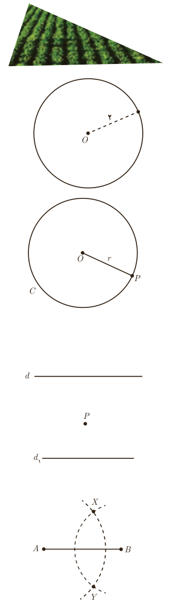

# درس اول ـ ترسیم‌های هندسی

انسان از دیرباز برای حل بسیاری از مسائل خود از ترسیم‌های هندسی کمک گرفته است. فرض کنید بخواهیم زمینی مثلث شکل را تنها با کشیدن یک دیوار مستقیم به دو قسمت هم‌مساحت تقسیم نماییم. چگونه می‌توان این کار را انجام داد؟

## فعالیت

۱. یک نقطۀ ثابت در صفحه، مانند $O$ را در نظر بگیرید و تمام نقاطی را که به فاصلۀ ثابت ۲ سانتی‌متر از آن هستند در نظر بگیرید. این نقاط چه شکلی را تشکیل می‌دهند؟

۲. یک دایره به مرکز $O$ و به شعاع ۲ سانتی‌متر بکشید و یک نقطۀ دلخواه روی آن در نظر بگیرید. فاصلۀ این نقطه تا مرکز دایره چقدر است؟

نتیجه: دایرۀ $C(O,r)$ (بخوانید دایرۀ $C$ به مرکز $O$ و به شعاع $r$) را در نظر بگیرید. هر نقطه که از نقطۀ $O$ به فاصلۀ $r$ باشد .... دایره قرار دارد و هر نقطه که .... دایره قرار دارد از نقطۀ $O$ به فاصلۀ $r$ است.

۳. مانند آنچه برای نقاط روی دایره انجام داده شد، یک‌بار برای نقاط داخل دایره و یک‌بار برای نقاط بیرون دایره نتایج مشابهی به‌دست آورید.

۴. خطی مانند $d$ در نظر بگیرید. تمام نقاطی را که به فاصلۀ ۲ سانتی‌متر از خط $d$ هستند مشخص کنید. این نقاط چه شکلی یا شکل‌هایی را تشکیل می‌دهند؟

۵. نقطۀ $P$ به فاصلۀ ۱ سانتی‌متر از خط $d_1$ قرار دارد.

الف) تمام نقاطی را که به فاصلۀ ۲ سانتی‌متر از نقطۀ $P$ هستند، مشخص کنید.

ب) نقاطی از خط $d_1$ را که به فاصلۀ ۲ سانتی‌متر از نقطۀ $P$ هستند، مشخص کنید.

۶. نقاط $A$ و $B$ را به فاصلۀ ۵ سانتی‌متر از هم در نظر بگیرید. به مرکز $A$ و به شعاع ۴ سانتی‌متر یک کمان رسم کنید و سپس به مرکز $B$ و به شعاع ۳ سانتی‌متر کمانی دیگر رسم کنید تا دو کمان یکدیگر را در نقاطی مانند $X$ و $Y$ قطع کنند.

الف) اندازۀ اضلاع مثلث‌های $AXB$ و $AYB$ را مشخص کنید.

ب) توضیح دهید که چگونه می‌توانید مثلثی به طول ضلع‌های داده شدۀ ۴ و ۵ و ۷ رسم کنید.

