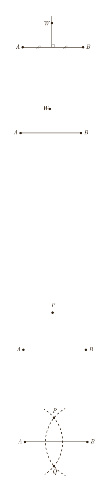

## برخی خواص عمود منصف و ترسیم آن

۱ـ در شکل مقابل پاره‌خط $AB$ و عمودمنصف آن مشخص شده‌اند. نقطه‌ای دلخواه مانند $W$ روی عمودمنصف $AB$ در نظر بگیرید و نشان دهید $W$ از دو سر $AB$ به یک فاصله است.

نتیجۀ ۱: هر نقطه روی عمودمنصف یک پاره‌خط از دو سر آن پاره‌خط .... .

۲ـ پاره‌خط $AB$ و نقطۀ $W$ مانند شکل مقابل به‌گونه‌ای قرار دارند که $W$ از دو سر $AB$ به یک فاصله است (یعنی $AW=BW$). نشان دهید $W$ روی عمودمنصف $AB$ قرار دارد. (راهنمایی: از $W$ به $A$ و $B$ و به وسط $AB$ وصل کنید و با استفاده از هم‌نهشتی مثلث‌ها نشان دهید $W$ روی عمودمنصف $AB$ قرار دارد.)

نتیجۀ ۲: هر نقطه که از دو سر یک پاره‌خط به فاصلۀ یکسان باشد .... .

از (۱) و (۲) نتیجه می‌گیریم: هر نقطه که روی عمودمنصف یک پاره‌خط باشد از .... و هر نقطه که از .... روی عمودمنصف آن پاره‌خط قرار دارد.

## فعالیت

۱. نقطۀ $P$ در صفحه مشخص شده است. چند خط می‌توانید رسم کنید که از نقطۀ $P$ عبور نمایند؟

۲. دو نقطۀ $A$ و $B$ در صفحه مشخص شده‌اند. چند خط متمایز می‌توانید رسم کنید که از هر دو نقطۀ $A$ و $B$ عبور نمایند؟

۳. به‌نظر شما برای اینکه یک خط مشخص شود حداقل چند نقطه از آن باید مشخص شده باشد؟

## رسم عمود منصف یک پاره‌خط داده شده

می‌خواهیم عمودمنصف پاره‌خط $AB$ را رسم کنیم.

۱ـ دهانۀ پرگار را بیش از نصف طول $AB$ باز کنید و یک بار به مرکز نقطۀ $A$ و بار دیگر به همان شعاع و به مرکز $B$ کمان بزنید تا دو کمان یکدیگر را در نقاطی مانند $P$ و $Q$ قطع کنند.

۲ـ آیا نقاط $P$ و $Q$ نقاطی متعلق به عمودمنصف $AB$ هستند؟ چرا؟

۳ـ آیا با داشتن نقاط $P$ و $Q$ می‌توان عمودمنصف $AB$ را مشخص کرد؟ چرا؟

۴ـ حال عمودمنصف $AB$ را رسم کنید.

