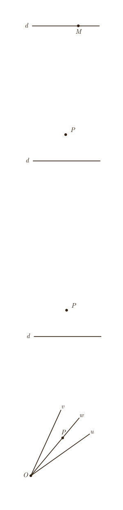

## رسم خط عمود بر یک خط، از نقطه‌ای روی آن

خط $d$ و نقطۀ $M$ روی آن مانند شکل مشخص شده‌اند. می‌خواهیم خطی رسم کنیم که از $M$ بگذرد و بر خط $d$ عمود باشد.

۱ـ به کمک پرگار نقاطی مانند $A$ و $B$ بر خط $d$ بیابید که $AM=MB$ باشد.

۲ـ عمودمنصف پاره‌خط $AB$ را رسم کنید.

۳ـ عمودمنصف پاره‌خط $AB$ خطی است که بر خط $d$ .... و از نقطۀ .... .

## رسم خط عمود بر یک خط، از نقطه‌ای غیر واقع بر آن

خط $d$ و نقطۀ $P$ مانند شکل داده شده‌اند. می‌خواهیم خطی رسم کنیم که از نقطۀ $P$ بگذرد و بر خط $d$ عمود باشد.

۱ـ به کمک پرگار نقاطی مانند $A$ و $B$ را بر خط $d$ به‌گونه‌ای بیابید که از نقطۀ $P$ به یک فاصله باشند.

۲ـ عمودمنصف پاره‌خط $AB$ را رسم کنید.

۳ـ آیا عمودمنصف پاره‌خط $AB$ از نقطۀ $P$ می‌گذرد؟ چرا؟ عمودمنصف پاره‌خط $AB$ بر خط $d$ .... و از نقطۀ .... .

## رسم خط موازی با خط داده شده از نقطه‌ای غیر واقع بر آن

خط $d$ و نقطۀ $P$ مانند شکل مقابل داده شده‌اند. می‌خواهیم خطی رسم کنیم که از نقطۀ $P$ بگذرد و با خط $d$ موازی باشد.

۱ـ خط $d_1$ را به‌گونه‌ای رسم کنید که از نقطۀ $P$ بگذرد و بر خط $d$ عمود باشد.

۲ـ خط $d_2$ را به‌گونه‌ای رسم کنید که از نقطۀ $P$ بگذرد و بر خط $d_1$ عمود باشد.

۳ـ خط $d_2$ نسبت به خط $d$ چه وضعیتی دارد؟ چرا؟ (خط $d_1$ را مورب در نظر بگیرید.)

## برخی خواص نیمساز و ترسیم آن

۱ـ در شکل مقابل نیم‌خط $Ow$ نیمساز زاویۀ $vOu$ است. فرض کنید $P$ یک نقطۀ دلخواه روی $Ow$ باشد. ثابت کنید فاصلۀ نقطۀ $P$ از دو ضلع زاویۀ $vOu$ یکسان است. (یعنی اگر از نقطۀ $P$ عمودهایی بر $Ov$ و $Ou$ رسم کنیم، طول آنها باهم برابر است.)

نتیجۀ ۱: هر نقطه روی نیمساز یک زاویه، از دو ضلع آن زاویه .... .

