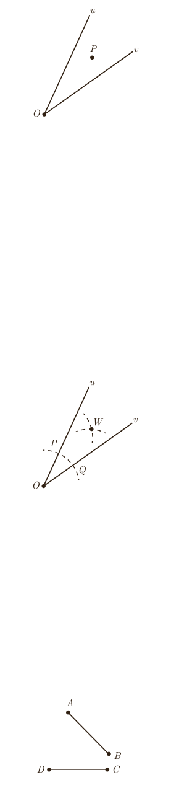

۲ـ در شکل مقابل فاصلۀ نقطۀ $P$ از دو ضلع زاویۀ $vOu$ یکسان است. نشان دهید که نقطۀ $P$ روی نیمساز زاویه قرار دارد. (راهنمایی: پاره‌خط $OP$ را و دو عمود از نقطۀ $P$ بر $Ou$ و $Ov$ رسم کنید و با استفاده از هم‌نهشتی مثلث‌ها نشان دهید $OP$ همان نیمساز زاویۀ $uOv$ است.)

نتیجۀ ۲: هر نقطه که از دو ضلع یک زاویه به فاصلۀ یکسان باشد، روی .... .

از (۱) و (۲) نتیجه می‌گیریم: هر نقطه که روی .... یک زاویه قرار داشته باشد، از .... و هر نقطه که از دو ضلع یک زاویه به یک فاصله باشد، روی .... آن زاویه قرار دارد.

۳ـ رسم نیمساز یک زاویه

الف) زاویۀ $uOv$ را در نظر بگیرید. به مرکز $O$ و به شعاع دلخواه کمانی رسم کنید تا نیم‌خط‌های $Ou$ و $Ov$ را در نقاطی مانند $P$ و $Q$ قطع کند.

ـ طول پاره‌خط‌های $OP$ و $OQ$ نسبت به هم چگونه‌اند؟

ب) دهانۀ پرگار را کمی بیش از نصف طول پاره‌خط $PQ$ باز کنید و یک بار به مرکز $P$ و بار دیگر به مرکز $Q$ کمانی رسم کنید تا دو کمان مانند شکل یکدیگر را در نقطه‌ای مانند $W$ قطع کنند. طول پاره‌خط‌های $PW$ و $QW$ نسبت به هم چگونه‌اند؟

پ) پاره‌خط‌های $WP$، $WO$ و $WQ$ را رسم کنید. دو مثلث $OPW$ و $OQW$ نسبت به هم چگونه‌اند؟ چرا؟

ـ اندازۀ زاویه‌های $POW$ و $QOW$ نسبت به هم چگونه‌اند؟ چرا؟

ـ پاره‌خط $OW$ .... زاویۀ $uOv$ است.

## تمرین

۱. الف) دو پاره‌خط $AB$ و $CD$ مطابق شکل داده شده‌اند. نقطه‌ای بیابید که از دو نقطۀ $A$ و $B$ به یک فاصله باشد و از دو نقطۀ $C$ و $D$ نیز به یک فاصله باشد.

ب) نقطۀ موردنظر در قسمت (الف) را $O$ می‌نامیم. اگر نقطۀ $O$ روی عمود منصف پاره‌خط $BC$ باشد و $G$ دایره‌ای به مرکز $O$ و به شعاع $OA$ باشد، رأس‌های چهارضلعی $ABCD$ نسبت به دایرۀ $G$ چه وضعیتی دارند؟ چرا؟

