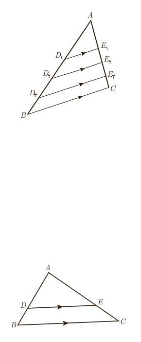

## استدلال، قضیۀ تالس و تعمیم آن

در شکل مقابل داریم: $D_1E_1\parallel BC$ و $D_2E_2\parallel BC$ و $D_3E_3\parallel BC$. این اطلاعات را می‌توان به این صورت نشان داد: $D_iE_i\parallel BC$ برای $1\le i\le3$.

ـ اندازۀ پاره‌خط‌های زیر را با خط‌کش مشخص کرده و در کسرها جایگزین کنید و نسبت‌های برابر در ستون‌های متمایز را مشخص نمایید.

$$\frac{AD_1}{D_1B},\quad\frac{AD_2}{D_2B},\quad\frac{AD_3}{D_3B}$$
$$\frac{AE_1}{E_1C},\quad\frac{AE_3}{E_3C},\quad\frac{AE_2}{E_2C}$$

ـ اگر پاره‌خط $DE$ مانند شکل روبه‌رو موازی ضلع $BC$ از مثلث $ABC$ باشد، حدس می‌زنید نسبت کدام پاره‌خط‌ها با هم برابر باشند؟ $\ldots=\ldots$

آیا می‌توان نتیجه گرفت اگر خطی موازی یکی از اضلاع مثلث رسم شود، همواره تساوی مشابه بالا برقرار است؟

در سال‌های قبل دیدید که نمی‌توان به درست بودن نتیجه‌ای که بر اساس مشاهدۀ چند مورد به‌دست آمده باشد، مطمئن بود.

این نوع از استدلال که در آن با مشاهده و بررسی یک موضوع در چند حالت، نتیجه‌ای کلی از آن گرفته می‌شود؛ یعنی «از جزء به کل می‌رسیم»، استدلال استقرایی نامیده می‌شود.

استدلال استنتاجی، استدلالی است که بر اساس نتیجه‌گیری منطقی بر پایۀ واقعیت‌هایی که درستی آنها را پذیرفته‌ایم، بیان می‌شود.

در ریاضیاتی که تاکنون خوانده‌اید، با مواردی از استدلال‌های استنتاجی مواجه شده‌اید. در ادامه با استدلال استنتاجی، نتیجه‌ای را که با استدلال استقرایی به‌دست آوردیم، ثابت خواهیم کرد.

