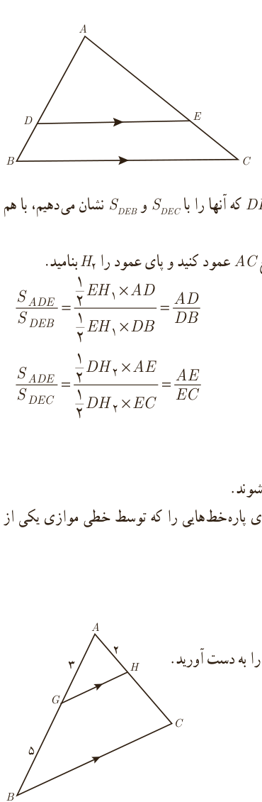

## قضیۀ تالس
### فعالیت

فرض کنید مانند شکل مقابل پاره‌خط $DE$ موازی ضلع $BC$ باشد. می‌خواهیم نشان دهیم: $\frac{AD}{DB}=\frac{AE}{EC}$.

۱. از نقطۀ $D$ به $C$ و از $E$ به $B$ وصل کنید. مساحت‌های مثلث‌های $DEC$ و $DEB$ که آنها را با $S_{DEC}$ و $S_{DEB}$ نشان می‌دهیم، با هم برابرند. چرا؟

۲. از نقطۀ $E$ به ضلع $AB$ عمود کنید و پای عمود را $H_1$ بنامید. سپس از $D$ به ضلع $AC$ عمود کنید و پای عمود را $H_2$ بنامید.

۳. $\frac{S_{ADE}}{S_{DEB}}=\frac{\frac12 EH_1\times AD}{\frac12 EH_1\times DB}=\frac{AD}{DB}$

۴. $\frac{S_{ADE}}{S_{DEC}}=\frac{\frac12 DH_2\times AE}{\frac12 DH_2\times EC}=\frac{AE}{EC}$

۵. از (۱) و (۳) و (۴) نتیجه می‌شود $\frac{AD}{DB}=\frac{AE}{EC}$. چرا؟

برخی نتایج مهم و پرکاربرد که با استدلال استنتاجی به‌دست می‌آیند، قضیه نامیده می‌شوند. نتیجۀ بالا قضیه‌ای از تالس¹ است. همان‌گونه که مشاهده کردید، رابطه بین طول‌های پاره‌خط‌هایی را که توسط خطی موازی یکی از اضلاع مثلث، بر دو ضلع دیگر آن مثلث به‌وجود می‌آید، بیان می‌کند.

## کار در کلاس

۱. در شکل پاره‌خط‌های $GH$ و $BC$ موازی‌اند. اندازۀ پاره‌خط‌های $AC$ و $HC$ را به دست آورید.

۱ـ فیلسوف و ریاضی‌دان که حدود ۶۲۳ سال قبل از میلاد در نواحی غرب ترکیۀ امروزی به دنیا آمد. اثبات بسیاری از قضایای مهم هندسی را به او نسبت داده‌اند.

