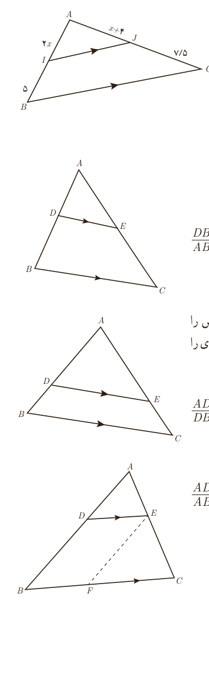

۲. با تشکیل یک معادله، مقدار $x$ و اندازۀ پاره‌خط‌های $AI$ و $AJ$ را به دست آورید.

## تعمیم قضیۀ تالس
### فعالیت

۱. در شکل مقابل $DE\parallel BC$.

الف) تناسب قضیۀ تالس را بنویسید.

ب) به کمک ترکیب نسبت در مخرج تناسب $\frac{AD}{AB}=\frac{AE}{AC}$ را نتیجه بگیرید.

پ) به کمک تفصیل نسبت در صورت از تناسب به‌دست آمده در (ب) تناسب $\frac{DB}{AB}=\frac{EC}{AC}$ را نتیجه بگیرید.

توجه کنید که تناسب‌های به‌دست آمده در (ب) و (ج) صورت‌های دیگر قضیۀ تالس‌اند.

۲. در مثلث $ABC$ پاره‌خط $DE$ موازی ضلع $BC$ است. ابتدا تناسب قضیۀ تالس را بنویسید. سپس با توجه به ویژگی‌های تناسب و تکمیل تساوی‌های زیر، تناسب‌های دیگری را از قضیۀ تالس نتیجه بگیرید.

$$\frac{AD}{DB}=\ldots\Rightarrow\begin{cases}\frac{DB}{DA}=\ldots&\frac{BD}{BA}=\ldots&\frac{AB}{BD}=\ldots\\\frac{AD}{AB}=\ldots&\frac{AB}{AD}=\ldots\end{cases}$$

۳. الف) در شکل پاره‌خط‌های $DE$ و $BC$ موازی‌اند. با توجه به قضیۀ تالس داریم: $\frac{AD}{AB}=\ldots$.

ب) پاره‌خط $EF$ را موازی $AB$ رسم می‌کنیم. بنابراین داریم: $\frac{BF}{BC}=\ldots$.

پ) با توجه به قسمت‌های (الف) و (ب) داریم: $\frac{AD}{AB}=\frac{\ldots}{AC}=\frac{\ldots}{BC}$.

ت) چهارضلعی $DEFB$ چه نوع چهارضلعی‌ای است؟ پاره‌خط $BF$ با کدام پاره‌خط برابر است؟ $BF=\ldots$

ث) با توجه به قسمت‌های (پ) و (ت) داریم: $\frac{AD}{AB}=\frac{\ldots}{AC}=\frac{\ldots}{BC}$.

این رابطه تعمیم قضیۀ تالس است.

