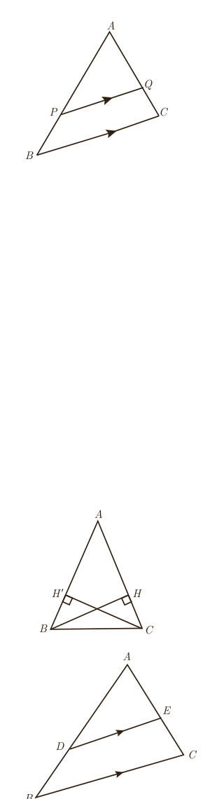

## کار در کلاس

در شکل پاره‌خط $PQ$ موازی با ضلع $BC$ است. درستی یا نادرستی هر عبارت را مشخص کنید.

الف) $\frac{AP}{PB}=\frac{AQ}{QC}=\frac{PQ}{BC}$؛ ب) $\frac{AP}{AB}=\frac{AQ}{AC}=\frac{PQ}{BC}$؛ پ) $\frac{PB}{AP}=\frac{QC}{AC}$؛ ت) $\frac{PB}{AB}=\frac{QC}{AC}=\frac{PQ}{BC}$؛ ث) $\frac{PB}{AB}=\frac{QC}{AC}$؛ ج) $\frac{AB}{AP}=\frac{AC}{AQ}=\frac{BC}{PQ}$.

اگر فرض و حکم یک قضیه را جابه‌جا کنیم، آنچه حاصل می‌شود، «عکس قضیه» است. عکس یک قضیه می‌تواند درست یا نادرست باشد.

در مثال‌های زیر قضیه و عکس آن آمده است.

مثال ۱: قضیه: اگر یک چهارضلعی متوازی‌الاضلاع باشد، آنگاه قطرهایش یکدیگر را نصف می‌کنند.

عکس قضیه: اگر در یک چهارضلعی قطرها یکدیگر را نصف کنند، آنگاه آن چهارضلعی متوازی‌الاضلاع است.

مثال ۲: قضیه: اگر دو ضلع از یک مثلث با هم برابر باشند، آنگاه ارتفاع‌های وارد بر آن دو ضلع نیز با هم برابرند.

فرض: $AB=AC$؛ حکم: $BH=CH'$

عکس قضیه: اگر دو ارتفاع از یک مثلث با هم برابر باشند، آنگاه اضلاع نظیر به آن ارتفاع‌ها نیز با هم برابرند.

فرض: $BH=CH'$؛ حکم: $AB=AC$

مثال ۳: در قضیۀ تالس فرض و حکم به صورت زیر است.

فرض: $DE\parallel BC$؛ حکم: $\frac{AD}{DB}=\frac{AE}{EC}$.

