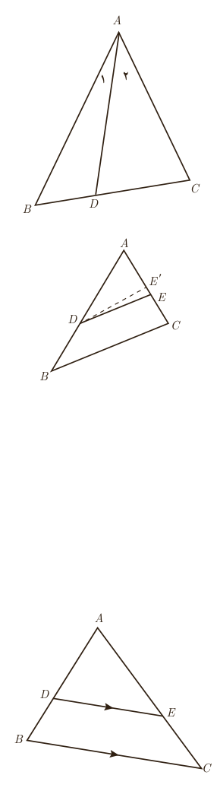

نوشت $n=2k$ به‌طوری که $k$ یک عدد طبیعی باشد.

بنابراین $n^2=4k^2=2(2k^2)$ که عددی زوج است و با فرض مسئله در تناقض است؛ لذا از ابتدا $n$ نمی‌توانست عددی زوج باشد.

مثال: فرض کنیم $AD$ نیمساز زاویۀ $A$ از مثلث $ABC$ باشد. اگر $BD\ne DC$ باشد، آن‌گاه $AB\ne AC$.

حل: با استفاده از برهان خلف فرض می‌کنیم حکم نادرست باشد. بنابراین داریم $AB=AC$ (فرض خلف). در این صورت خواهیم داشت $\triangle ABD\cong\triangle ACD$ (چرا؟). از این هم‌نهشتی نتیجه خواهد شد $BD=DC$ است، که با فرض مسئله در تناقض است. لذا از ابتدا فرض $AB=AC$ نادرست بوده است، بنابراین $AB\ne AC$ است.

حال می‌خواهیم با استفاده از برهان خلف درستی عکس قضیۀ تالس را ثابت کنیم.

عکس قضیۀ تالس: مانند شکل مقابل در مثلث $ABC$، اگر $\frac{AE}{EC}=\frac{AD}{DB}$، آن‌گاه $DE\parallel BC$.

اثبات: با استفاده از برهان خلف فرض می‌کنیم حکم مسئله غلط باشد؛ یعنی $DE\nparallel BC$. لذا از نقطۀ $D$ خطی موازی $BC$ رسم می‌کنیم تا $AC$ را در نقطه‌ای مانند $E'$ قطع کند. طبق قضیۀ تالس داریم $\frac{AE'}{E'C}=\frac{AD}{DB}$ و از مقایسه با فرض مسئله خواهیم داشت $\frac{AE}{EC}=\frac{AE'}{E'C}$. حال با ترکیب نسبت در مخرج داریم $\frac{AE}{AC}=\frac{AE'}{AC}$ و در نتیجه $AE=AE'$. این یعنی نقطۀ $E$ بر $E'$ منطبق است و لذا $DE'$ همان $DE$ است و این یک تناقض است، زیرا $DE'\parallel BC$ و $DE\nparallel BC$ است. بنابراین از ابتدا فرض غلط بودن حکم نادرست بوده است و حکم نمی‌تواند غلط باشد، یعنی $DE\parallel BC$ است.

## قضیه‌های دو شرطی

همان‌گونه که دیدیم، قضیۀ تالس و عکس آن هر دو درست‌اند؛ بنابراین برای مثلثی مانند $ABC$ در شکل مقابل می‌توان هر دوی آنها را به‌صورت زیر بیان کرد:

اگر $DE\parallel BC$، آن‌گاه $\frac{AD}{DB}=\frac{AE}{EC}$ و برعکس.

چنین قضیه‌هایی را قضیه‌های دو شرطی می‌نامیم. قضیه‌های دو شرطی را با نماد $\Leftrightarrow$¹

۱ـ این نماد نشان‌دهندۀ آن است که هر کدام از طرفین می‌توانند طرف دیگر را نتیجه دهند؛ لذا یا هر دو طرف درست‌اند و یا هر دو طرف نادرست‌اند.

