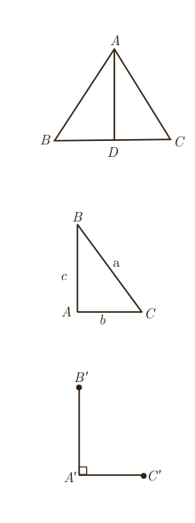

(که اگر و تنها اگر خوانده می‌شود) بیان کرد؛ به‌طور مثال قضیۀ فوق و عکس آن را می‌توان به‌صورت زیر بیان کرد:

فرض کنیم $ABC$ یک مثلث و نقاط $D$ و $E$ به ترتیب روی $AB$ و $AC$ باشند. در این صورت:

$$\frac{AD}{DB}=\frac{AE}{EC}\Leftrightarrow DE\parallel BC$$

در ادامه مثال‌هایی از قضایای دو شرطی ملاحظه خواهید کرد.

مثال: در یک مثلث دو ضلع برابرند؛ اگر و تنها اگر زاویه‌های روبه‌رو به آنها باهم برابر باشند.

مثال: در مثلث متساوی‌الاضلاع یک پاره‌خط نیمساز است؛ اگر و تنها اگر میانه باشد.

## کار در کلاس

با توجه به قضیۀ فیثاغورس اگر زاویۀ $A$ از مثلثی مانند $ABC$، قائمه باشد، آنگاه $a^2=b^2+c^2$.

الف) عکس این قضیه را بنویسید.

ب) با انجام مراحل زیر نتیجه بگیرید که عکس قضیۀ فیثاغورس نیز درست است.

۱ـ فرض کنیم مثلث $ABC$ داده شده است و رابطۀ $a^2=b^2+c^2$ بین اندازۀ اضلاع آن برقرار است.

۲ـ پاره‌خط‌های $A'B'$ و $A'C'$ را مطابق شکل مقابل به گونه‌ای درنظر بگیرید که $\hat A'=90^\circ$ و $A'C'=AC$ و $A'B'=AB$ است.

۳ـ با استفاده از قضیۀ فیثاغورس در مثلث $A'B'C'$، اندازۀ پاره‌خط $B'C'$ را به‌دست آورید و ثابت کنید $B'C'=BC$.

۴ـ توضیح دهید چرا $\triangle ABC\cong\triangle A'B'C'$ و نتیجه بگیرید $\hat A=90^\circ$.

ج) قضیۀ فیثاغورس و عکس آن را به‌صورت یک قضیۀ دو شرطی بیان کنید.

## مثال نقض

نوع دیگری از استدلال که در پایه‌های قبل نیز تا حدودی با آن آشنا شده‌اید، استدلال با مثال نقض است. اگر فردی ادعا کند که «همۀ اعداد فرد، اول‌اند»، این یک حکم کلی دربارۀ تمام اعداد فرد است و ارائۀ عدد ۹ به عنوان عددی که فرد و غیر اول است، برای رد این ادعا کافی است. به چنین مثالی که برای رد یک حکم کلی استفاده می‌شود، مثال نقض می‌گوییم.

به عنوان مثالی دیگر؛ فرض کنیم فردی ادعا کند که «هیچ فرد ایرانی‌ای تا به حال مدال

